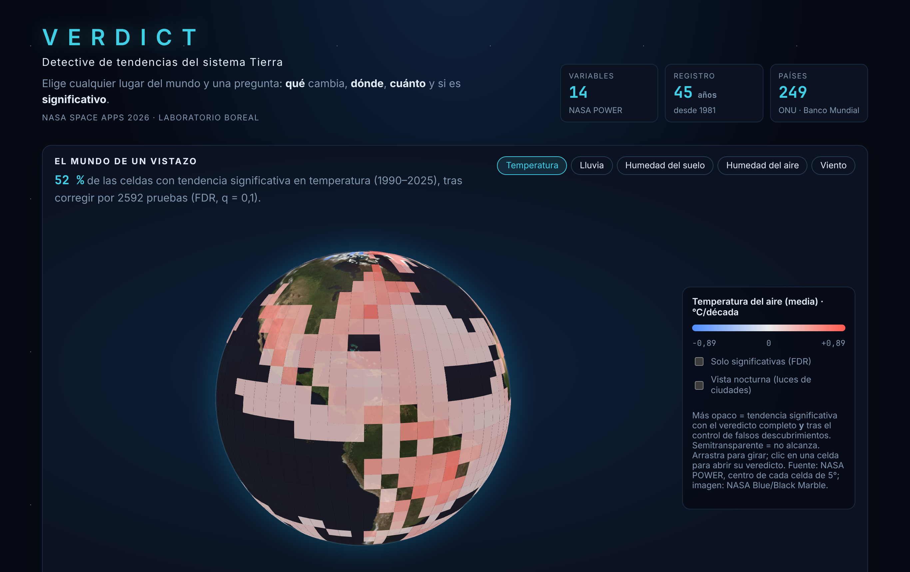
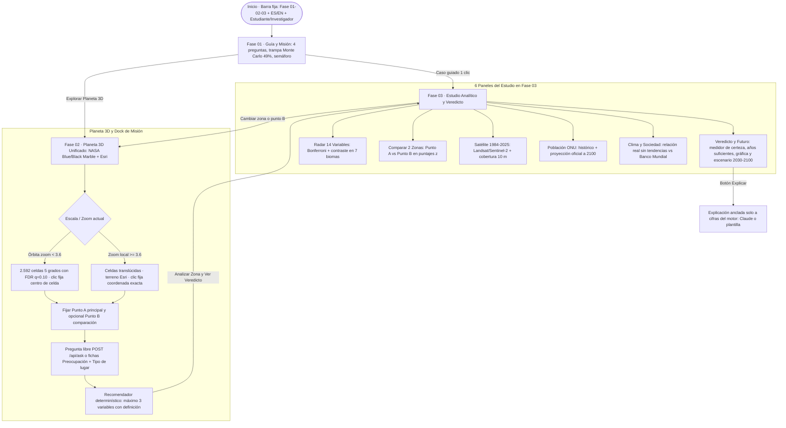
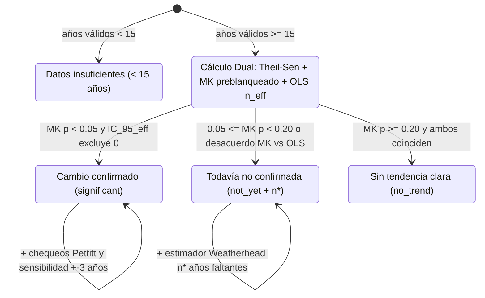
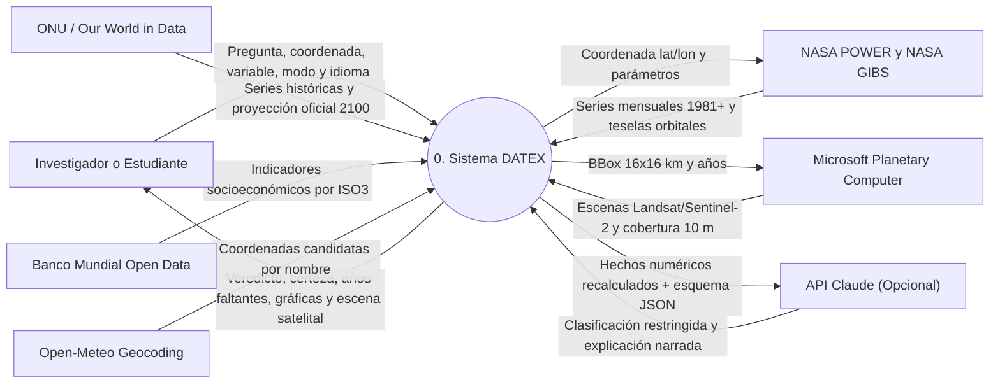
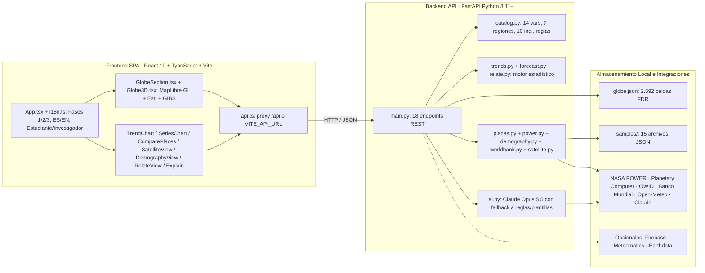

<a id="inicio"></a>

# DATEX — Especificación técnica del proyecto · NASA Space Apps 2026

<p align="center">
  
</p>

<p align="center">
  
  &nbsp;
  
</p>

**Equipo:** Boreal Labs · **Universidad Americana (UAM) · Nicaragua** · **Reto:** *Be an Earth System Trend Detective* (NASA Space Apps Challenge 2026)

**Revisión:** 14 de noviembre de 2026 · **Corte técnico:** Backend `0.2.0` (FastAPI + Python ≥ 3.11) + Frontend React 19 / TypeScript / MapLibre GL 5, arquitectura progresiva en **3 fases**, **globo 3D unificado** con transición orbital-a-terreno, **modo dual Estudiante / Investigador**, interfaz bilingüe **ES / EN** y **72 pruebas automatizadas** aprobadas.

**Estado:** Prototipo funcional completo de extremo a extremo, validado por simulación Monte Carlo y listo para despliegue y demostración final.

[Índice de lectura](#indice) · [English Executive Summary](#english) · [Flujo de usuario](#usuarios) · [Diagramas DFD](#dfd) · [Motor estadístico](#motor) · [Stack técnico](#stack) · [Ejecutar el proyecto](#instalacion)

DATEX es una plataforma científica abierta e interactiva que permite a **estudiantes, docentes, investigadores y tomadores de decisiones locales** investigar si el clima o la superficie terrestre están cambiando en **cualquier coordenada del planeta**. Responde de forma rigurosa pero comprensible a las cuatro preguntas del reto —**qué** cambia, **dónde**, **cuánto** y si el cambio es **estadísticamente significativo o simple variabilidad natural**— evitando la trampa clásica de las rectas de tendencia ingenuas que producen hasta **49 % de falsas alarmas** cuando los datos ambientales tienen "memoria" (autocorrelación).

El proyecto combina una sección **guía/educativa** (*Fase 01*) respaldada por el sistema de diseño [Orbital Observatory](docs/DESIGN.md), un **planeta 3D unificado** (*Fase 02*) donde las **2.592 celdas globales de 5°** se vuelven translúcidas al hacer zoom sobre cualquier ciudad o valle para revelar terreno satelital de alta resolución, y un **estudio analítico adaptativo** (*Fase 03*) que alterna en vivo entre **🎓 Modo Estudiante** (medidores visuales de certeza, barra de años suficientes y lenguaje llano) y **🔬 Modo Investigador** (Mann-Kendall con preblanqueo, regresión con $n_{\text{efectivo}}$, saltos Pettitt y tablas comparativas).

Este README constituye la especificación técnica y científica integral de DATEX: documenta la problemática, los actores y modos de audiencia, la experiencia en tres fases, el modelado lógico DFD (enfoque Kendall y Kendall), el motor estadístico validado por simulación, las 14 variables y 18 rutas REST, la arquitectura física, las pruebas automatizadas y la guía completa de ejecución.

> **Repositorio:** [GitHub · jamesjsfouam/NasaSpaceapp](https://github.com/jamesjsfouam/NasaSpaceapp)  
> **Documento de diseño UX:** [docs/DESIGN.md](docs/DESIGN.md) · **Entrega oficial en inglés:** [docs/SUBMISSION_EN.md](docs/SUBMISSION_EN.md) · **Análisis base:** [PDF del equipo](docs/Earth_System_Trend_Detective_analisis_y_solucion.pdf)

<a id="indice"></a>

## Índice de lectura

| Área | Qué encontrarás | Accesos directos |
| --- | --- | --- |
| **00 · English Overview** | Resumen ejecutivo y técnico en inglés para el jurado internacional | [English Summary](#english) |
| **01 · Proyecto y reto** | Problemática, alcance, perfiles, identidad visual y matriz del reto | [Propósito y límites](#problema) · [Actores y modos](#actores) · [Identidad visual](#identidad) · [Entregables](#entregables) |
| **02 · Experiencia en 3 fases** | Recorrido completo, globo 3D unificado, paneles simplificados y veredictos | [Flujo de usuarios](#usuarios) · [Las 3 fases y modo dual](#fases) · [Protocolo del veredicto](#veredicto) |
| **03 · Modelado y estadística** | DFD lógico (Kendall y Kendall), contratos de datos, motor estadístico y fuentes NASA | [DFD Contexto y Diagrama 0](#dfd) · [Datos y anclaje IA](#datos) · [Motor estadístico y Monte Carlo](#motor) · [Variables y fuentes](#fuentes) |
| **04 · Desarrollo técnico** | Arquitectura física, stack por capas, contrato de API, código real e instalación | [Arquitectura](#arquitectura) · [Stack completo](#stack) · [Paneles web y API](#paneles) · [Estado del código](#codigo) · [Instalación](#instalacion) · [Rigor y seguridad](#seguridad) · [Pruebas](#pruebas) |
| **05 · Gestión y entrega** | Avance actual, pendientes antes del cierre, biblioteca documental y colaboración | [Estado del desarrollo](#decisiones) · [Próximos pasos](#pendientes) · [Biblioteca](#documentacion) · [Colaboración](#colaboracion) |

**Para evaluar o presentar el proyecto:** lee [English Executive Summary](#english) → [propósito](#problema) → [experiencia en 3 fases](#usuarios) → [validación Monte Carlo](#simulacion).  
**Para desarrollar o desplegar:** ve directo a [arquitectura de componentes](#arquitectura) → [stack completo](#stack) → [contratos de la API REST](#api) → [ejecución e instalación](#instalacion).

<details>
<summary><strong>Cómo leer los modelos y convenciones de este documento</strong></summary>

- **Flujo de usuario (`flowchart TD`):** describe pantallas, fases de navegación, acciones del usuario y decisiones de interfaz.
- **DFD lógico (Kendall y Kendall):** muestra entidades externas, procesos numerados (`1.0` a `6.0`), almacenes lógicos (`D1` a `D4`) y flujos de datos sin asumir botones ni infraestructura física.
- **Arquitectura de componentes (`flowchart LR`):** describe módulos reales de software (`React`, `FastAPI`, servicios Python, archivos JSON de respaldo y APIs externas).
- **Implementado:** código existente, probado y compilado en la rama `main` (`backend/tests/`, `frontend/src/`). **En preparación / pendiente:** acciones operativas externas al código fuente (despliegue en la nube, grabación del video de 30 s / 7 diapositivas y contraste opcional con GPM/SMAP vía Earthdata).

</details>

---

<a id="english"></a>

## 0. Executive Summary (English · NASA Space Apps 2026)

**DATEX** (*Be an Earth System Trend Detective*) is a bilingual (**EN / ES**) scientific web application built by **Boreal Labs (UAM Nicaragua)** to investigate climate and land-surface change **anywhere on Earth**.

### Core Innovation
1. **3-Phase Progressive Experience (`01 · Briefing` → `02 · Unified 3D Planet` → `03 · Verdict Studio`):** Replaces cluttered single-page dashboards with a guided scientific narrative backed by [docs/DESIGN.md](docs/DESIGN.md).
2. **One Unified 3D Planet (Macro + Micro Zoom):** Powered by MapLibre GL, **NASA GIBS** (Blue Marble & VIIRS Black Marble), and Esri World Imagery. Shows **2,592 five-degree global trend cells** with Benjamini–Hochberg False Discovery Rate (FDR, $q = 0.10$) from orbit, then smoothly fades cell fill opacity as users zoom down to reveal high-resolution terrain where any exact coordinate can be clicked.
3. **Dual Audience Mode (`🎓 Student` / `🔬 Researcher`):** Translates statistical mechanics into visual **Statistical Certainty Meters**, **Data Sufficiency Progress Bars** (*years observed vs. years required*), and clean annual charts for students, while exposing full Prewhitened Mann-Kendall ($\tau, p$), Effective-Sample OLS ($n_{\text{eff}}, r, p$), Pettitt step-change alerts, and period-sensitivity flags for researchers.
4. **Autocorrelation-Resistant Dual Engine (Monte Carlo Validated):** Eliminates up to **6× more false alarms** than naive regression on 30-year zero-trend AR(1) series:

| Climate Memory ($\phi$) | Standard Regression (False Positives) | Prewhitening Only | Effective-$n$ Only | **DATEX Dual Engine (Both + Bias Fix)** |
| --- | --- | --- | --- | --- |
| $\phi = 0.0$ (No memory) | 4.8% | 3.8% | 4.3% | **3.6%** |
| $\phi = 0.4$ (Moderate) | 19.3% | 11.0% | 8.7% | **4.8%** |
| $\phi = 0.8$ (Strong) | 49.0% | 23.1% | 13.1% | **8.2%** |

5. **100% Functional with Zero API Keys:** Runs on public **NASA POWER** (MERRA-2 / CERES, 1981–present), **NASA GIBS**, **Microsoft Planetary Computer STAC** (Landsat 5/7/8/9 & Sentinel-2, 1984–2025 + 10 m Annual Land Cover), **UN World Population Prospects** (via Our World in Data, 249 ISO3 territories), **World Bank Open Data**, and **Open-Meteo + GeoNames** offline geocoding, plus bundled offline JSON samples (`backend/app/data/samples/`) and deterministic rule/template fallbacks when `ANTHROPIC_API_KEY` is absent.

> For full English judge copy, AI disclosure, and the 30-second / 7-slide demo script, read [docs/SUBMISSION_EN.md](docs/SUBMISSION_EN.md).

[↑ Volver al índice](#indice)

---

<a id="proyecto"></a>

# I. Proyecto y problemática

Contexto científico, problema estadístico que resuelve DATEX, audiencia y alineación oficial con el reto de la NASA.

<a id="problema"></a>

## 1. Problema, propósito y alcance

El reto oficial *Be an Earth System Trend Detective* plantea responder cuatro preguntas sobre la Tierra: **¿qué cambia?, ¿dónde?, ¿cuánto? y ¿es estadísticamente significativo?** Sin embargo, al construir una herramienta abierta para estudiantes e investigadores surgen tres fallos críticos que suelen arruinar la validez o la usabilidad de los paneles convencionales:

1. **La trampa de la memoria climática (autocorrelación):** los años cálidos, húmedos o secos tienden a agruparse en rachas naturales (como los ciclos El Niño / La Niña). Una regresión lineal ordinaria asume que cada año es independiente y declara tendencias "significativas" entre un **19,3 %** ($\phi = 0,4$) y un **49,0 %** ($\phi = 0,8$) de las veces aunque no exista ningún cambio real.
2. **Interfaz fragmentada en una sola página:** amontonar globos 3D, mapas 2D redundantes, formularios y tablas estadísticas sin narrativa introductoria desorienta al usuario antes de que formule su pregunta.
3. **Jerga estadística hermética vs. rigor científico:** mostrar únicamente `mk_p`, `ols_p`, $\tau$ o $n_{\text{efectivo}}$ intimida a estudiantes de secundaria o pregrado, mientras que ocultar esos parámetros resta rigor frente a investigadores y jueces científicos.

**Propósito de DATEX:** democratizar la detección honesta de tendencias ambientales mediante seis módulos integrados:

1. **Guía de Misión y Método (Fase 01):** onboarding visual en menos de 45 segundos sobre las 4 preguntas, la trampa de las falsas alarmas, el semáforo de veredictos y casos guiados en 1 clic.
2. **Planeta 3D Unificado y Recomendador (Fase 02):** un único globo interactivo que une la vista orbital (2.592 celdas de 5° con control FDR) con el zoom local sobre imágenes satelitales reales, más un asistente de preguntas libres y recomendador determinístico de hasta **3 variables**.
3. **Estudio de Veredicto y Escenarios Futuros (Fase 03):** cálculo dual (Theil–Sen + Mann-Kendall con preblanqueo + OLS con $n_{\text{efectivo}}$), años necesarios para confirmar tendencia, extrapolación lineal etiquetada como escenario (2030–2100) y explicación en lenguaje llano con IA anclada a cifras.
4. **Radar de 14 Variables y Regiones de Contraste (Fase 03):** escaneo simultáneo de las 14 variables de NASA POWER con corrección de Bonferroni y comparación en 7 biomas de referencia.
5. **Comparador Geográfico e Imágenes Satelitales (Fase 03):** contraste paralelo de dos coordenadas mediante series estandarizadas ($z$-scores), lapso temporal Landsat/Sentinel-2 (1984–2025) y cobertura anual del suelo a 10 m.
6. **Demografía ONU y Acoplamiento Socioeconómico (Fase 03):** proyecciones oficiales de la ONU hasta 2100 y detección de correlaciones ilusorias (*trend-driven*) frente a correlación año a año sin tendencia con indicadores del Banco Mundial.

### Alcance y límites honestos del sistema

- **Solo tendencias lineales de largo plazo:** según el alcance del reto y [docs/RETO.md](docs/RETO.md), no modela cambios no lineales complejos; cuando un salto brusco explica mejor la serie que una recta (prueba de Pettitt, p < 0,05 y reducción de error $\text{RSS}_{\text{salto}} < 0{,}7 \cdot \text{RSS}_{\text{recta}}$), la herramienta **advierte** explícitamente sobre el año del salto.
- **Datos de reanálisis (MERRA-2), no estaciones locales:** cada celda de NASA POWER cubre aproximadamente `50 × 60 km` y combina modelos físicos con satélites que cambian con el tiempo (por ejemplo, saltos conocidos alrededor de 1987 en precipitación o ~1999 en humedad en Bluefields). Cada variable incluye su nota de fiabilidad.
- **Escenario ≠ Predicción:** las proyecciones lineales hasta 2030–2100 muestran *"qué pasaría si el ritmo lineal observado continuara"*; nunca se presentan como pronóstico climático ni sustituyen a modelos globales o cohortes demográficas de la ONU.
- **Correlación ≠ Causación:** cruzar una coordenada puntual con un indicador nacional del Banco Mundial incluye advertencia obligatoria y exige al menos **10 años en común**.

[↑ Volver al índice](#indice)

<a id="actores"></a>

## 2. Personas, perfiles de usuario y modos de operación

| Perfil / Actor | Objetivo principal | Modo recomendado y acceso en DATEX |
| --- | --- | --- |
| **Estudiante (secundaria / universidad)** | Comprender qué está cambiando en su ciudad o región sin ahogarse en estadística | **🎓 Modo Estudiante** (por defecto): medidores de certeza en `%`, barra de años faltantes, gráficas limpias (anual + tendencia), avisos traducidos y casos en 1 clic. |
| **Investigador o docente** | Auditar significancia, tamaño de muestra efectivo, saltos estructurales y falsos descubrimientos | **🔬 Modo Investigador:** tabla dual completa (`MK p`, `τ`, `OLS p_eff`, `n_eff`, lag-1 `r` corregida), anomalías mensuales, p ajustada Bonferroni/FDR y prueba Pettitt. |
| **Jurado de NASA Space Apps** | Verificar validez científica, uso de datos NASA, claridad bilingüe y reproducibilidad sin claves | Selector **EN / ES** en la barra superior, tabla Monte Carlo en Fase 01, respaldo offline y documentación en [docs/SUBMISSION_EN.md](docs/SUBMISSION_EN.md). |
| **Ciudadano / gestor local** | Explorar si la sequía, el calor nocturno o la urbanización local coinciden con datos satelitales | Pregunta en lenguaje natural en Fase 02, zoom directo a su ciudad sobre terreno satelital y timelapse Landsat/Sentinel-2. |
| **Asistente IA acotado (Claude)** | Traducir preguntas libres al catálogo y redactar explicaciones comprensibles | **Sin cálculo autónomo:** recibe esquema JSON estricto o cifras ya recalculadas por el backend; degradación elegante a reglas/plantillas sin clave. |
| **Modo sin conexión / muestras** | Garantizar demostraciones estables cuando NASA POWER o el Banco Mundial fallen o vayan lentos | Respaldo local en `backend/app/data/samples/` (7 regiones + 4 países) y malla global precalculada en `backend/app/data/globe.json`. |

[↑ Volver al índice](#indice)

<a id="identidad"></a>

## 3. Identidad visual ("Orbital Observatory")

El sistema visual está especificado en [docs/DESIGN.md](docs/DESIGN.md) e implementado en [frontend/src/index.css](frontend/src/index.css). Evoluciona el tema oscuro original de control de misión hacia una estética glassmórfica de observatorio orbital legible tanto para exposición en proyector como para lectura académica.

| Elemento / Token | Especificación verificada | Uso semántico en la interfaz |
| --- | --- | --- |
| **Fondo espacial profundo** | `#040812` con resplandor radial orbital `#0d1e38` | Lienzo base de las 3 fases |
| **Superficie de paneles (Glass)** | `rgba(11, 19, 34, 0.84)` + `backdrop-filter: blur(14px)` + borde `#1b2a42` | HUD flotante del globo 3D y contenedores del estudio |
| **Tarjetas elevadas** | `#0f1a2d` | Tarjetas KPI, explicaciones y tablas comparativas |
| **Veredicto confirmado (Significativa)** | Cian `#3fd0e6` + Esmeralda `#34d399` | Tendencias confirmadas, marcador del punto principal (**Punto A**) y certeza alta |
| **Veredicto en observación (Todavía no)** | Ámbar `#f2b84b` | Series con señal parcial o métodos en desacuerdo (junto a años faltantes) |
| **Sin tendencia clara / Estable** | Pizarra frío `#9aabc4` | Variabilidad sin dirección sostenida o series estables |
| **Escenarios futuros e IA** | Violeta suave `#a78bfa` | Extrapolación 2030–2100 con banda del 95 % y botón/panel **Explicar** |
| **Segundo punto de comparación** | Naranja coral `#f59e42` | Marcador **Punto B** en el globo 3D y serie secundaria en *Comparar 2 zonas* |
| **Tipografías** | `'Inter', system-ui, sans-serif` + monoespaciada `tabular-nums` (clase `.num`) | Prosa editorial (`line-height: 1.55`) y alineación exacta de cifras científicas |

[↑ Volver al índice](#indice)

<a id="entregables"></a>

## 4. Entregables del reto y matriz de cumplimiento

| Requisito oficial de *Be an Earth System Trend Detective* | Cómo lo implementa DATEX | Archivo / módulo principal |
| --- | --- | --- |
| **1. Identificar variables con potencial de tendencia** | Pregunta libre (IA o reglas por palabras clave), preguntas guiadas (preocupación + tipo de lugar → recomendador de hasta 3 variables) y radar de las 14 variables | `backend/app/catalog.py`, `ai.py`, `GlobeSection.tsx` |
| **2. Obtener datos de una región o lugar** | Cualquier coordenada del planeta mediante búsqueda global (Open-Meteo), clic en cualquier punto del globo 3D (zoom local) y detección offline de país (GeoNames) | `places.py`, `power.py`, `Globe3D.tsx` |
| **3. Visualizar una serie temporal larga** | Datos mensuales desde 1981 (NASA POWER); gráfica interactiva con alternancia entre **Vista Simple** (media anual + recta + escenario) y **Vista Completa** (+ anomalías mensuales) | `TrendChart.tsx`, `SeriesChart.tsx`, `trends.py` |
| **4. Tasa de cambio y prueba de significancia** | Pendiente de Theil–Sen por década + IC 95 %, Mann-Kendall con preblanqueo y regresión con $n_{\text{efectivo}}$; veredicto honesto en 4 niveles | `trends.py`, `App.tsx` |
| **5. Enfoque educativo para estudiantes** | Fase 01 informativa, casos guiados en 1 clic, **Modo Estudiante** con medidores visuales y glosario llano, botón **Explicar** anclado a cifras | `App.tsx`, `i18n.ts`, `Explain.tsx` |
| **6. Mostrar tendencias regionales opuestas** | Comparador lado a lado de cualquier par de puntos (`Spot A` vs. `Spot B`) con $z$-scores y tabla comparativa en 7 biomas globales | `ComparePlaces.tsx`, `App.tsx` (`/api/compare`) |
| **7. Extensión más allá del reto (valor agregado)** | Globo 3D FDR global (2.592 celdas), timelapse Landsat/Sentinel-2 + cobertura anual 10 m, demografía ONU a 2100 y acoplamiento sin tendencias con Banco Mundial | `build_globe.py`, `satellite.py`, `demography.py`, `relate.py` |

[↑ Volver al índice](#indice)

---

<a id="experiencia"></a>

# II. Experiencia en 3 fases y operación del detective

Arquitectura de experiencia de usuario que guía desde la alfabetización científica hasta la inspección planetaria y el veredicto adaptativo.

<a id="usuarios"></a>

## 5. Flujo de investigación del usuario

1. **Entrada y alfabetización científica (Fase 01 · `briefing`):** el usuario comprende las 4 preguntas del detective, observa mediante la tabla Monte Carlo por qué las gráficas simples producen hasta 49 % de falsas alarmas, aprende los 3 colores del semáforo y puede lanzar un caso guiado en 1 clic o avanzar al Planeta 3D.
2. **Selección espacial y de pregunta en un solo planeta (Fase 02 · `planet`):**
   - Desde órbita ve las 2.592 celdas de 5° con control FDR y cambia entre **Día (Blue Marble)**, **Noche (Black Marble)** o **Solo FDR significativo**.
   - Busca una ciudad por nombre, elige un atajo regional o hace clic y zoom en el globo: el relleno de la malla se vuelve translúcido y revela el terreno satelital para fijar el **Punto A** (o activar la selección del **Punto B**).
   - En el panel lateral de **Control de Misión** escribe una pregunta libre (ej. *"¿se está secando el suelo de mis cultivos en Somoto?"*) o marca una preocupación y tipo de lugar para recibir hasta **3 variables recomendadas** con definición y nota de fiabilidad.
3. **Veredicto y exploración multidimensional (Fase 03 · `studio`):** una banda superior fija mantiene visible el lugar, las coordenadas, la variable y el año de inicio mientras el usuario recorre 6 vistas especializadas y cambia libremente entre **ES / EN** y **🎓 Estudiante / 🔬 Investigador**, pudiendo volver con un clic a **🌍 Cambiar zona en el planeta**.

### Recorrido integrado en 3 fases



| Fase | Entrada principal | Salida y acción siguiente | Recuperación ante errores o sin red |
| --- | --- | --- | --- |
| **01 · Guía y Misión** | Lectura rápida o elección de uno de los 4 casos guiados | Salto al Planeta 3D o carga directa del Estudio con la región y variable del caso | Todo el contenido es estático/bilingüe; funciona 100 % sin conexión externa. |
| **02 · Planeta 3D Unificado** | Clic en celda/terreno, búsqueda por nombre o pregunta libre | Coordenada fijada (`Spot A` y opcional `Spot B`), país ISO3 resuelto offline y variable + año inicial elegidos | Si Open-Meteo o Claude no responden, funciona la selección directa en el globo y el recomendador por palabras clave. |
| **03 · Paneles Estadísticos** | Análisis calculado sobre NASA POWER, Planetary Computer, OWID o Banco Mundial | Veredicto en 4 niveles, gráficas, escenarios futuros y explicación narrada | Si falla la red en las 7 regiones o 4 países de muestra, usa automáticamente `backend/app/data/samples/`; fuera de muestras muestra aviso claro `HTTP 502` y sugiere un punto cercano. |

[↑ Volver al índice](#indice)

<a id="fases"></a>

## 6. Arquitectura de las 3 fases y modo dual Estudiante / Investigador

### Detalle de unificación espacial en el Planeta 3D (`Globe3D.tsx` + `GlobeSection.tsx`)

En lugar de mantener un globo ornamental separado de un mapa 2D en Leaflet (`MapPicker.tsx`, conservado como pieza histórica del primer corte), el proyecto unifica toda la interacción espacial sobre **MapLibre GL v5 en proyección de globo**:

- **Transición visual orbital → local:**
  - Las teselas de fondo mezclan **NASA GIBS Blue Marble** (o **VIIRS Black Marble** en modo nocturno) con **Esri World Imagery**, cuya opacidad raster interpola de `0` a `1` entre zoom `3.5` y `5.8`.
  - Simultáneamente, la capa GeoJSON de las **2.592 celdas** interpola su `fill-opacity` de `1.0` (zoom `2`) → `0.72` (zoom `4.2`) → `0.22` (zoom `6.2`) → `0.08` (zoom `8.5`), dejando líneas sutiles de referencia (`cells-grid`) mientras deja ver calles, cultivos, costas y ríos debajo.
- **Comandos de cámara del HUD flotante:**
  - `Vista global` → vuela a zoom `1.9` en `1100 ms`.
  - `Zoom a la zona` → vuela al **Punto A** a zoom `6.8` en `1300 ms`.
  - Selección desde buscador/chip → centra suavemente a `max(zoom, 4.2)` en `1000 ms`.
- **Precisión dual al clic:** con `zoom < 3.6` selecciona el centro de la celda de 5° consultada; con `zoom >= 3.6` captura la coordenada geográfica exacta con 4 decimales y coloca marcadores GeoJSON diferenciados (`spot-halo` + `spot-dot`) en cian para el **Punto A** y coral para el **Punto B**.

<a id="modos"></a>

### Simplificación de datos: comparación entre Modos de Audiencia

El selector global **🎓 Estudiante / 🔬 Investigador** transforma en tiempo real los componentes de la Fase 03 (`App.tsx`, `TrendChart.tsx`, `ComparePlaces.tsx`, `RelateView.tsx`, `DemographyView.tsx`, `SatelliteView.tsx`, `i18n.ts`):

| Elemento en pantalla | 🎓 Modo Estudiante (Accesible / Visual) | 🔬 Modo Investigador (Rigor Estadístico) |
| --- | --- | --- |
| **Resumen del veredicto** | Frase humana directa traducida (`humanVerdictSummary`), evitando afirmar cambios no confirmados | Interpretación completa con intervalo de confianza de Theil–Sen al 95 % |
| **Indicador de significancia** | **Medidor visual de certeza** (`0–100 %`, derivado de $1 - p$) con etiqueta llana (*Muy poco probable por azar*, *Señal intermedia*, *Parece variación natural*) | Valores exactos de `MK p` (preblanqueado), $\tau$ de Kendall, `OLS p` con $n_{\text{efectivo}}$, autocorrelación lag-1 $r$ corregida y bandera de acuerdo entre métodos |
| **Horizonte de datos necesarios** | **Barra de progreso de suficiencia**: *X de Y años observados (~Z años más para confirmar)* | Parámetros de la fórmula de Weatherhead et al. (1998) adaptada a medias anuales con ajuste AR(1) |
| **Gráfica de serie temporal** | Por defecto en **Vista Simple**: solo promedio anual + recta de Theil–Sen + escenario futuro (botón disponible para ver detalle mensual) | Por defecto en **Vista Completa**: anomalías mensuales desestacionalizadas + promedio anual + recta Theil–Sen + banda 95 % del escenario |
| **Tarjeta de Rigor Metodológico** | Colapsada por defecto bajo *"¿Cómo funciona el cálculo?"* | Abierta por defecto mostrando tabla comparativa Motor Dual vs. Regresión ingenua |
| **Avisos de fiabilidad** | Consejos accionables en lenguaje llano (`translateWarning`: ej. contrastar con otro satélite por posible cambio de instrumento) | Detalle técnico exacto (`step_year` de Pettitt, sensibilidad al periodo $\pm 3$ años, $r > 0{,}5$, extensión del horizonte $> n/2$) |
| **Clima y Sociedad (`relate`)** | Barra visual de fuerza de acoplamiento + alerta clara de *"falsa coincidencia por tendencia común"* | Coeficientes `raw_r` / `raw_p` frente a `detrended_r` / `detrended_p` de Pearson y $\rho$ / $p$ de Spearman sin tendencias |

[↑ Volver al índice](#indice)

<a id="veredicto"></a>

## 7. Protocolo del veredicto estadístico y escenarios futuros

El motor clasifica toda serie analizada en **cuatro veredictos excluyentes** (implementados en `trends.py` y reflejados semánticamente en `App.tsx` e `i18n.ts`):

| Estado / Código | Condición matemática exacta | Etiqueta en UI (ES / EN) | Semántica e información adicional |
| --- | --- | --- | --- |
| `significant` | $\text{MK}_{\text{preblanq}}\ p < 0{,}05$ **y** el IC 95 % de OLS con $n_{\text{efectivo}}$ **excluye el cero** | **Cambio confirmado** / *Confirmed change* | Ambas pruebas independientes superan el filtro anti-autocorrelación. |
| `not_yet` | $\text{MK}\ p \in [0{,}05,\, 0{,}20)$ **o** las dos pruebas no coinciden en significancia al 5 % | **Todavía no confirmada (en observación)** / *Not yet confirmed* | Se calcula e informa **$n^*$ (años totales requeridos y años que faltan)** para detectar ese ritmo con ~90 % de potencia. |
| `no_trend` | $\text{MK}\ p \ge 0{,}20$ y las dos pruebas coinciden en no significancia | **Sin tendencia clara** / *No clear trend* | La variación observada es indistinguible del ruido y la variabilidad natural del periodo. |
| `insufficient_data` | Menos de `15` años válidos ($\ge 10$ meses válidos por año en series mensuales) | **Datos insuficientes (`HTTP 422`)** | Impide emitir conclusiones prematuras sobre ventanas demasiado cortas. |

### Controles adicionales de honestidad

- **Sensibilidad al periodo (`period_sensitive`):** recalcula el veredicto moviendo el año inicial hasta `+3` años y el final hasta `-3` años; si el veredicto cambia, activa una advertencia visible.
- **Detección de saltos bruscos (`step_year` · prueba de Pettitt):** evalúa si un escalón abrupto en el año $k+1$ (frecuente cuando cambian satélites asimilados en MERRA-2) alcanza $p < 0{,}05$ y reduce la suma de cuadrados residuales al menos un 30 % frente a la recta ($\text{RSS}_{\text{salto}} < 0{,}7 \cdot \text{RSS}_{\text{recta}}$).
- **Horizonte de escenario futuro (`forecast.py`):** exige al menos **5 puntos anuales**, aplica límites físicos por unidad (`%` $\in [0, 100]$, proporción `0–1` $\in [0, 1]$, escala de razón $\ge 0$) y advierte siempre si el horizonte excede la mitad del periodo observado, si hay autocorrelación o si la tendencia base no es significativa.

<details>
<summary><strong>Ver diagrama de estados de decisión del veredicto (Mermaid)</strong></summary>



</details>

[↑ Volver al índice](#indice)

---

<a id="modelado"></a>

# III. Modelado de datos, motor estadístico y fuentes

Modelado lógico separado de la implementación física siguiendo **Kendall y Kendall** (*Systems Analysis and Design*, 10.ª ed.), junto con la formulación matemática verificada del motor estadístico y el inventario completo de fuentes de la NASA y organismos internacionales.

<a id="dfd"></a>

## 8. Flujo de datos lógico según Kendall y Kendall

### Diagrama de Contexto (Nivel 0)

El sistema lógico **DATEX (Proceso 0)** recibe consultas espaciales/temáticas del usuario y coordina la obtención de observaciones ambientales, satelitales, demográficas y socioeconómicas desde seis proveedores externos, devolviendo veredictos estadísticos auditables, escenarios futuros y explicaciones lingüísticas ancladas.



### Diagrama 0 · Descomposición de procesos y almacenes lógicos

Siguiendo las reglas de Kendall y Kendall, los números (`1.0`–`6.0`) identifican procesos lógicos de transformación (no orden temporal), sin rombos ni flujos directos entidad–almacén.

```mermaid
flowchart TD
    U["Investigador o Estudiante"] -->|"F01: Pregunta / preocupación / coordenada"| P1("1.0 Interpretar consulta y recomendar variables")
    P1 <-->|"Catálogo, reglas y sinónimos ES/EN"| D1[("D1 · Catálogo y diccionario bilingüe")]
    P1 -->|"F02: Lista <= 3 variables + lugar resuelto"| U

    U -->|"F03: Coordenada o nombre de lugar"| P2("2.0 Resolver ubicación y vista planetaria")
    OM["Open-Meteo"] -->|"Resultados geocodificados"| P2
    P2 <-->|"Celdas 5 grados con FDR q=0.10"| D2[("D2 · Malla global precalculada")]
    P2 -->|"F04: ISO3 país + malla global + marcador"| U

    U -->|"F05: Variable, lugar y rango de años"| P3("3.0 Analizar tendencias y escenarios")
    NP["NASA POWER"] -->|"Series mensuales 1981-2025"| P3
    P3 <-->|"Caché TTL y muestras offline"| D3[("D3 · Caché en memoria y muestras locales")]
    P3 -->|"F06: Veredicto dual, certeza, n*, sensibilidad y escenario"| U

    U -->|"F07: Solicitud de imagen o cobertura"| P4("4.0 Consultar evidencia satelital")
    PC["Planetary Computer"] -->|"URLs recorte Landsat/Sentinel y LULC"| P4
    P4 -->|"F08: Timelapse 1984-2025, clases suelo y escenario"| U

    U -->|"F09: País ISO3, indicador y variable"| P5("5.0 Integrar demografía ONU y sociedad")
    UN["ONU / OWID"] -->|"Estimaciones y proyección ONU"| P5
    WB["Banco Mundial"] -->|"Indicadores anuales"| P5
    P5 <-->|"Series cacheadas y muestras por país"| D3
    P5 -->|"F10: Tendencia país, proyección ONU y r sin tendencia"| U

    U -->|"F11: Petición Explicar e idioma"| P6("6.0 Generar explicación anclada a cifras")
    P3 -->|"Cifras recalculadas verificadas"| P6
    P4 -->|"Resumen cobertura suelo"| P6
    P5 -->|"Cifras demográficas y correlación"| P6
    CL["Claude API (opcional)"] <-->|"Solo hechos numéricos -> narrativa"| P6
    P6 <-->|"Plantillas y glosario llano"| D1
    P6 -->|"F12: Explicación física e hipótesis"| U
```



| Proceso lógico | Información que transforma | Almacenes que consulta |
| --- | --- | --- |
| **1.0 Interpretar consulta y recomendar** | Pregunta libre o par `(concern, place_type)` $\rightarrow$ hasta 3 variables del catálogo con definición y nota de fiabilidad | `D1` Catálogo, reglas `_RULES` / `_PLACE_TWEAKS` e idioma `ES/EN` |
| **2.0 Resolver ubicación y vista planetaria** | Nombre de lugar o coordenada `(lat, lon)` $\rightarrow$ país ISO3 offline (radio $\le 250\text{ km}$), lugar cercano y celdas de 5° filtradas por FDR | `D2` `globe.json` y tabla offline de GeoNames (`reverse_geocoder`) |
| **3.0 Analizar tendencias y escenarios** | Serie mensual `YYYYMM` $\rightarrow$ anomalías climatológicas, medias anuales ($\ge 10\text{ meses}$), Theil–Sen, MK preblanqueado, OLS $n_{\text{efectivo}}$, $n^*$, Pettitt y escenario 95 % | `D3` Caché 6 h y `samples/<region>.json` |
| **4.0 Consultar evidencia satelital** | Coordenada + rango $\rightarrow$ recorte cuadrado `bbox_around(lat, lon, 8 km)` con mínima nubosidad (`< 20 %`) y clases porcentuales `io-lulc-annual-v02` | Consulta STAC en vivo sin almacenamiento persistente |
| **5.0 Integrar demografía y sociedad** | Código `ISO3` + indicador + serie climática $\rightarrow$ tendencia anual, proyección ONU a 2100 y Pearson/Spearman con y sin tendencia | `D3` Caché 24 h y `samples/demography_*.json` / `worldbank_*.json` |
| **6.0 Generar explicación anclada** | Parámetros de consulta $\rightarrow$ **recalcula el análisis en servidor** y envía únicamente los hechos verificados a Claude (o plantilla determinística) | `D1` Plantillas bilingües `ES/EN` |

[↑ Volver al índice](#indice)

<a id="datos"></a>

## 9. Datos, contratos y límites de confianza

| Dominio / Objeto | Estructura y política de acceso | Garantía científica y límite de confianza |
| --- | --- | --- |
| **Catálogo (`Catalog`)** | 6 temas, 14 variables, 7 regiones, 4 demos, 10 indicadores del Banco Mundial, 7 indicadores demográficos ONU, 5 preocupaciones y 6 tipos de lugar | Definiciones y notas de fiabilidad versionadas en `catalog.py` y traducidas en `frontend/src/i18n.ts`. |
| **Caché de NASA POWER** | TTL en memoria de **6 horas** por coordenada; descarta centinelas `-999` y promedio anual sintético (mes `13`) | Ante caída de red, solo sustituye con muestra local si la coordenada cae dentro de `0,05°` de una de las 7 regiones de ejemplo; nunca fabrica datos sintéticos silenciosamente. |
| **Caché Demografía / Banco Mundial** | TTL en memoria de **24 horas** (OWID descarga una tabla CSV con todos los países en una sola llamada) | Separa explícitamente estimaciones históricas (`history`) de proyecciones de cohorte de la ONU (`un_projection`). |
| **Contrato estricto de IA (`/api/explain`)** | Recibe `ExplainRequest` (`kind`, parámetros, `lang` `es \| en`), **recalcula el análisis completo en el backend** | **La IA nunca lee números enviados desde el navegador**, tiene prohibido inventar cifras, debe presentar causas como hipótesis y respeta el veredicto fijo de `trends.py`. |
| **Privacidad y secretos** | Todo acceso a APIs externas ocurre desde el backend (excepto teselas públicas de mapas/imágenes); sin cuentas de usuario obligatorias | Las claves opcionales (`.env`) nunca se exponen en `frontend/`; Firebase solo se inicializa si existen `VITE_FIREBASE_*`. |

[↑ Volver al índice](#indice)

<a id="motor"></a>

## 10. Motor estadístico resistente a la autocorrelación y validación Monte Carlo

Implementado íntegramente en [backend/app/services/trends.py](backend/app/services/trends.py), [forecast.py](backend/app/services/forecast.py), [relate.py](backend/app/services/relate.py) y [scripts/build_globe.py](backend/scripts/build_globe.py):

1. **Desestacionalización y agregación anual:**
   - Para cada mes $m \in \{1..12\}$, se calcula su climatología $\bar{y}_m$ sobre la ventana elegida y se obtienen anomalías $a_{t,m} = y_{t,m} - \bar{y}_m$.
   - Cada año $t$ entra en la serie anual únicamente si posee al menos `MIN_MONTHS_PER_YEAR = 10` meses válidos (evitando sesgos por meses faltantes de verano o invierno), y se exige un mínimo de `MIN_YEARS = 15` años.
2. **Magnitud robusta:** pendiente mediana de **Theil–Sen** por década con intervalo de confianza del 95 %, acompañada de la pendiente OLS. Si la variable es de escala de razón (`ratio_scale = True`), reporta también cambio porcentual respecto al nivel inicial.
3. **Corrección de autocorrelación por sesgo de muestra pequeña (`lag1`):**
   Con ~30–36 años, la autocorrelación muestral lag-1 $r$ sobre residuos subestima la persistencia real $\phi$. El motor aplica la corrección de sesgo acotada al intervalo $[0,\ 0{,}95]$:

   $$r_{\text{corr}} = \min\!\left(0{,}95,\ \max\!\left(0,\ r + \frac{1 + 4r}{n}\right)\right)$$

4. **Doble prueba independiente de significancia:**
   - **Mann-Kendall con preblanqueo (`mk_prewhitened`):** remueve la tendencia de Theil–Sen para estimar $r_{\text{corr}}$ sobre los residuos y ejecuta la prueba sobre la serie preblanqueada $y_{t} - r_{\text{corr}}\, y_{t-1}$ (reportando el $\tau$ de Kendall original junto al $p$ preblanqueado). *Nota metodológica:* la variante modificada TFPW (*trend-free prewhitening*) fue evaluada y descartada por arrojar entre **20 % y 58 %** de falsos positivos.
   - **Regresión OLS con tamaño de muestra efectivo (`ols_effective`):** reduce los grados de libertad efectivos según $n_{\text{eff}} = \max\!\left(3,\ n \cdot \frac{1 - r_{\text{corr}}}{1 + r_{\text{corr}}}\right)$, reescala el error estándar mediante $\sqrt{(n-2)/(n_{\text{eff}}-2)}$ y construye el intervalo $t$ al 95 % sobre `df = max(1, n_eff - 2)`.
5. **Años necesarios para confirmar tendencia (`years_needed` · Weatherhead et al., 1998 adaptado a datos anuales):**

   $$n^* = \left\lceil \left( \frac{3{,}3 \cdot \sigma \cdot \sqrt{12}}{|\omega|} \cdot \sqrt{\frac{1 + r_{\text{corr}}}{1 - r_{\text{corr}}}} \right)^{2/3} \right\rceil$$

   donde $\sigma$ es la desviación estándar de los residuos y $\omega$ la pendiente anual de Theil–Sen.
6. **Control global de multiplicidad (`build_globe.py` y `trends.scan`):**
   - En las **2.592 celdas del globo**, aplica el control de tasa de falsos descubrimientos de **Benjamini–Hochberg ($q = 0{,}10$)** por variable para no pintar cientos de falsos positivos en un mapa planetario.
   - En el **Radar de 14 variables** en un mismo punto (`trends.scan`), reporta además el valor $p$ ajustado por **Bonferroni**.
7. **Correlación sin tendencias en Clima y Sociedad (`relate.py`):**
   - Calcula la correlación aparente de Pearson (`raw_r`, `raw_p`) y las correlaciones **año a año sin tendencia lineal** de Pearson (`detrended_r`, `detrended_p`) y Spearman (`detrended_rho`, `detrended_rho_p`) tras aplicar `_detrend(x, years)`. Marca `trend_driven = True` cuando `raw_p < 0,05` pero la relación sin tendencias no es significativa o cae en más de `0,3` en magnitud.

<a id="simulacion"></a>

### Validación por simulación Monte Carlo y hallazgos empíricos

Pruebas reproducibles en [backend/tests/test_trends.py](backend/tests/test_trends.py), [test_forecast.py](backend/tests/test_forecast.py) y [test_relate.py](backend/tests/test_relate.py) sobre series anuales sintéticas de **30 años sin tendencia real** bajo ruido AR(1) con parámetro $\phi$:

| Escenario de memoria climática ($\phi$) | Regresión ordinaria (ingenuo) | Solo preblanqueo MK | Solo $n_{\text{efectivo}}$ | **Motor DATEX (ambas pruebas + corrección de sesgo)** |
| --- | --- | --- | --- | --- |
| $\phi = 0{,}0$ (sin autocorrelación) | 4,8 % falsos positivos | 3,8 % | 4,3 % | **3,6 % falsos positivos** |
| $\phi = 0{,}4$ (memoria moderada) | 19,3 % falsos positivos | 11,0 % | 8,7 % | **4,8 % falsos positivos** (4× menos errores) |
| $\phi = 0{,}8$ (memoria fuerte) | 49,0 % falsos positivos | 23,1 % | 13,1 % | **8,2 % falsos positivos** (6× menos errores) |

- **Potencia y cobertura:** con $\phi = 0$ detecta una tendencia de $0{,}06\,\sigma/\text{año}$ en el **65 %** de los casos (frente a 74 % de la regresión ordinaria). Al llegar a $n^*$ años de Weatherhead, detecta la tendencia entre el **88 % y 96 %** de las simulaciones (meta teórica: 90 %). El intervalo de predicción de `forecast.py` logra cobertura simulada de **91 %–99 %**.
- **Efecto sobre datos reales (1990–2025, documentado en `docs/MEMORIA_PROYECTO.md`):** en temperatura media (`T2M`), **Svalbard (Ártico)** ($+0{,}73\,^\circ\text{C/década}$), **Sahara** ($+0{,}38\,^\circ\text{C/década}$) y **Ciudad de México** ($+0{,}40\,^\circ\text{C/década}$) permanecen **significativas**, mientras que **Managua** ($-0{,}21$), **Bluefields** ($+0{,}18$) y **Amazonía** ($+0{,}26$) pasan honestamente a *"todavía no significativas"* debido a autocorrelación entre $0{,}4$ y $0{,}6$, y Bluefields exhibe un salto Pettitt en ~1999 en humedad del suelo y relativa.

[↑ Volver al índice](#indice)

<a id="fuentes"></a>

## 11. Catálogo de las 14 variables de NASA y fuentes externas

### Las 14 variables de NASA POWER (`backend/app/catalog.py`)

| Clave API | Nombre (ES / EN) | Unidad | Tema | Escala de razón | Fuente específica y nota clave de fiabilidad |
| --- | --- | --- | --- | --- | --- |
| `T2M` | Temperatura del aire (media) / *Air temperature (mean)* | `°C` | Temperatura | No | MERRA-2 (NASA POWER) · Celda ~50 km; contrastable con AIRS |
| `T2M_MAX` | Temperatura máxima diaria / *Daily maximum temperature* | `°C` | Temperatura | No | MERRA-2 (NASA POWER) · Extremos diarios algo menos certeros que la media |
| `T2M_MIN` | Temperatura mínima diaria / *Daily minimum temperature* | `°C` | Temperatura | No | MERRA-2 (NASA POWER) · Ideal para detectar islas de calor nocturnas |
| `TS` | Temperatura de la superficie / *Surface skin temperature* | `°C` | Temperatura | No | MERRA-2 (NASA POWER) · Contrastable con MODIS desde 2000 (cielo despejado) |
| `PRECTOTCORR` | Precipitación / *Precipitation* | `mm/día` | Lluvia y agua | Sí | MERRA-2 corregida · Posibles saltos por cambio de satélite (~1987); contrastar con GPM IMERG |
| `EVLAND` | Evaporación del suelo / *Land evaporation* | `mm/día` | Lluvia y agua | Sí | MERRA-2 (NASA POWER) · Variable modelada; hereda saltos de la precipitación |
| `GWETROOT` | Humedad del suelo (raíces) / *Root-zone soil moisture* | `0–1` | Suelo y agricultura | Sí | MERRA-2 (NASA POWER) · Clave agrícola; contrastar con GLDAS o SMOS/SMAP |
| `GWETTOP` | Humedad del suelo (superficie) / *Surface soil moisture* | `0–1` | Suelo y agricultura | Sí | MERRA-2 (NASA POWER) · Primeros centímetros; contraste satelital SMOS/SMAP desde 2010/2015 |
| `RH2M` | Humedad relativa del aire / *Relative humidity* | `%` | Humedad y nubes | Sí | MERRA-2 (NASA POWER) · Sensible a cambios en sensores asimilados |
| `T2MDEW` | Punto de rocío / *Dew point temperature* | `°C` | Humedad y nubes | No | MERRA-2 (NASA POWER) · Sensible a cambios en sensores asimilados |
| `CLOUD_AMT` | Nubosidad / *Cloud cover* | `%` | Humedad y nubes | Sí | CERES / MERRA-2 · Difícil de medir de manera homogénea multidecadal |
| `ALLSKY_SFC_SW_DWN` | Radiación solar en superficie / *Surface solar irradiance* | `MJ/m²/día` | Energía solar | Sí | CERES (NASA POWER) · Registro satelital largo confiable para tendencias |
| `WS2M` | Velocidad del viento (2 m) / *Wind speed* | `m/s` | Viento y presión | Sí | MERRA-2 (NASA POWER) · Depende fuertemente de la rugosidad local |
| `PS` | Presión atmosférica / *Surface atmospheric pressure* | `kPa` | Viento y presión | Sí | MERRA-2 (NASA POWER) · Variable muy estable y bien observada |

> Cinco variables (`T2M`, `PRECTOTCORR`, `GWETROOT`, `RH2M`, `WS2M`) conforman además la malla global precalculada de **2.592 celdas** en `backend/app/data/globe.json`.

### Proveedores externos e inventario sin conexión

| Fuente externa | Qué aporta al sistema | Credenciales | Muestras sin conexión incluidas (`samples/`) |
| --- | --- | --- | --- |
| **NASA POWER** (`power.larc.nasa.gov`) | Series mensuales `AG` desde 1981 en cualquier coordenada | Ninguna | 7 regiones (`managua`, `corredor_seco`, `bluefields`, `amazonas`, `sahara`, `artico`, `cdmx`) |
| **NASA GIBS** (`gibs.earthdata.nasa.gov`) | Teselas `BlueMarble_NextGeneration` y `VIIRS_Black_Marble` | Ninguna | Requiere red para teselas base del globo; la malla GeoJSON es local |
| **Esri World Imagery** (`server.arcgisonline.com`) | Terreno satelital de alta resolución al hacer zoom local en el globo | Ninguna | Requiere red al hacer zoom regional (`zoom > 3.5`) |
| **OpenStreetMap** (`tile.openstreetmap.org`) y **Nominatim** (`nominatim.openstreetmap.org`) | Fondo "Calles" del mapa y, solo si el usuario pulsa "Usar mi ubicación", el nombre del lugar (reverse geocoding) | Ninguna | Requiere red; se respeta la política de uso razonable de OSM (sin carga masiva) |
| **Microsoft Planetary Computer** (`planetarycomputer.microsoft.com`) | Escenas Landsat 5/7/8/9 (1984+) y Sentinel-2 L2A (2016+); `io-lulc-annual-v02` (2017–2023) | Ninguna (`PC_SDK_SUBSCRIPTION_KEY` opcional) | Consulta en vivo; maneja errores elegantemente en UI |
| **ONU via Our World in Data** (`ourworldindata.org`) | 7 indicadores demográficos y proyección oficial de variante media a 2100 | Ninguna | 4 países (`NIC`, `BRA`, `DZA`, `MEX`) |
| **Banco Mundial** (`api.worldbank.org/v2`) | 10 indicadores agrícolas, económicos y sociales | Ninguna | 4 países (`NIC`, `BRA`, `DZA`, `MEX`) |
| **Open-Meteo + GeoNames** (`reverse_geocoder` + `pycountry`) | Búsqueda de ciudades en vivo y resolución offline de país ISO3 ($\le 250\text{ km}$) | Ninguna | Resolución de coordenadas 100 % offline |
| **Anthropic Claude (`claude-opus-5-5`)** | Clasificación de pregunta libre y explicación narrada en `es \| en` | `ANTHROPIC_API_KEY` opcional | Reglas léxicas y plantillas científicas bilingües offline |
| **Meteomatics / Earthdata / Firebase** | Tiempo actual (`/api/weather`), catálogo STAC avanzado y persistencia opcional | Claves en `.env` / `.env.local` | Opcionales; la app principal opera al 100 % sin ellas |

[↑ Volver al índice](#indice)

---

<a id="desarrollo"></a>

# IV. Especificación para desarrollo

Componentes reales de software, dependencias verificadas, contrato de endpoints, estado comprobable del repositorio e instrucciones de ejecución.

<a id="arquitectura"></a>

> **Mapas de Google (opcional, no activado).** El mapa usa MapLibre con teselas abiertas (Esri, NASA GIBS, OSM). Para añadir Google Maps haría falta una clave de la *Map Tiles API* en una variable de entorno `VITE_GOOGLE_MAPS_API_KEY` (se expone en el navegador: restringirla por dominio en Google Cloud) y crear una sesión de teselas 2D; el código no la lee todavía.

## 12. Arquitectura de componentes del sistema



| Componente físico | Responsabilidad exacta | Estado comprobado |
| --- | --- | --- |
| **Frontend SPA (`frontend/src/`)** | 3 fases UX, selector bilingüe `ES/EN`, modo dual, globo MapLibre 3D, 6 vistas analíticas y gráficas Recharts | **Implementado y compilado** (`tsc -b && vite build`, 0 errores) |
| **Globo 3D (`Globe3D.tsx`, `globeColors.ts`)** | Proyección globo, interpolación zoom `2 → 8.5`, hover, marcadores `Spot A`/`B`, capa nocturna | **Implementado** con `maplibre-gl` `5.24.1` |
| **Mapa 2D previo (`MapPicker.tsx`)** | Picker Leaflet del primer corte antes de la unificación en 3D | **Legado / en desuso en la UI activa** (conservado en `src/`) |
| **API FastAPI (`backend/app/main.py`)** | Exposición de 18 endpoints REST, validación Pydantic v2, CORS y recálculo previo para IA | **Implementado** y cubierto por `test_api.py` |
| **Motor estadístico (`trends.py`, `forecast.py`, `relate.py`)** | Anomalías, Theil–Sen, MK preblanqueado, OLS $n_{\text{eff}}$, Weatherhead $n^*$, Pettitt, correlación sin tendencias | **Implementado y validado** con simulación Monte Carlo en `pytest` |
| **Conectores de datos + muestras** | Descarga asíncrona `httpx`, caché TTL (6 h / 24 h) y respaldo JSON local en `backend/app/data/` | **Implementado** (`globe.json` + 15 archivos JSON de muestra) |
| **Integración Firebase / Cloud (`firebase.py`, `firebase.ts`, `firebase.json`)** | Hosting estático de `frontend/dist` y helper opcional de Firestore (`cloud` extra) | **Listo para configurar credenciales y desplegar** |

[↑ Volver al índice](#indice)

<a id="stack"></a>

## 13. Lenguajes y recursos técnicos de todo el sistema

Versiones exactas tomadas de [backend/pyproject.toml](backend/pyproject.toml), [frontend/package.json](frontend/package.json) y [ci.yml](.github/workflows/ci.yml):

| Capa | Lenguaje | Paquetes y versiones mínimas/instaladas | Propósito en el proyecto |
| --- | --- | --- | --- |
| **Interfaz Web (UI)** | TypeScript (`~7.0.2`) + TSX + CSS | `react` `^19.3.1`, `react-dom` `^19.3.1`, `@vitejs/plugin-react` `^6.1.2`, `vite` `^8.3.6` | SPA reactiva, sistema de diseño propio en `index.css` y diccionarios en `i18n.ts` |
| **Globo 3D y visualización** | TypeScript + WebGL / SVG | `maplibre-gl` `^5.24.1`, `recharts` `^3.10.1` (`leaflet` `^1.9.4` / `react-leaflet` `^5.0.0` legados) | Globo 3D unificado con teselas NASA GIBS/Esri y gráficas responsivas de series, comparaciones y cobertura |
| **API Web del servidor** | Python (`>= 3.11`) | `fastapi>=0.115`, `uvicorn[standard]>=0.30`, `pydantic-settings>=2.4`, `httpx>=0.27` | Endpoints REST tipados, clientes HTTP asíncronos y configuración central desde `.env` |
| **Computación científica** | Python | `numpy>=2.0`, `pandas>=2.2`, `scipy>=1.14` | Cálculos vectorizados de Mann-Kendall, Theil–Sen, `linregress`, `t` de Student, Pearson y Spearman |
| **Geocodificación offline** | Python | `reverse-geocoder>=1.5.1`, `pycountry>=26.2.16` | Asignación sin internet de país ISO3 y localidad cercana a partir de cualquier `(lat, lon)` |
| **IA generativa acotada** | Python | `anthropic>=1.0` (`claude-opus-5-5`, beta `server-side-fallback-2026-07-01`) | Salida estructurada por `output_config` JSON y explicación lingüística en `es \| en` |
| **Extras satelitales y nube (opcionales)** | Python / JS | Grupo `geo`: `earthaccess`, `xarray`, `netcdf4`, `rasterio`, `geopandas`, `planetary-computer`, `pystac-client`. Grupo `cloud`: `firebase-admin`, `google-cloud-storage`, `azure-storage-blob`, `azure-identity`. Frontend: `firebase` `^13.3.0` | Acceso directo a colecciones MODIS/GPM/AIRS, firma STAC de Planetary Computer y despliegue en Google Cloud / Azure |
| **Calidad, pruebas y notebooks** | Python / Shell / Node 22+ | `pytest>=8.3`, `pytest-asyncio>=1.5.0`, `ruff>=0.6`, `oxlint` `^1.90.0`, `jupyterlab>=4.2`, `ipykernel>=6.29`, `matplotlib>=3.9`, `uv` | Suites estadísticas y offline, linting estricto en CI y exploración reproducible en `notebooks/01_exploracion.ipynb` |

[↑ Volver al índice](#indice)

<a id="paneles"></a>

## 14. Sitio web de paneles y contrato de la API REST

### Los 6 paneles analíticos de la Fase 03

| Pestaña / ID | Componente Frontend | Qué muestra y qué simplifica para el usuario |
| --- | --- | --- |
| **`trend` · Veredicto y Futuro** | `App.tsx` + `TrendChart.tsx` + `Explain.tsx` | Tarjeta semáforo del veredicto, 4 tarjetas KPI (dirección, ritmo/década, medidor visual de certeza, barra de años suficientes), alternancia Vista Simple / Completa, escenarios 2030–2100, tarjeta de rigor dual y botón Explicar |
| **`scan` · Radar 14 Variables** | `App.tsx` (`/api/scan` + `/api/compare`) | Escanea simultáneamente las 14 variables de NASA POWER en el punto elegido ordenadas por evidencia (con $p$ ajustada por Bonferroni) y muestra la respuesta global de la variable activa en las 7 regiones |
| **`compare` · Comparar 2 Zonas** | `ComparePlaces.tsx` | Enfrenta **Punto A** vs. **Punto B** lado a lado con tarjetas de veredicto independientes, dirección opuesta resaltada y gráfica de anomalías estandarizadas ($z$-score) |
| **`satellite` · Satélite 1984–2025** | `SatelliteView.tsx` | Recortes de `16 × 16 km` de Landsat 5/7/8/9 y Sentinel-2 año por año con control deslizante, clasificación anual de cobertura del suelo (`10 m`, 2017–2023), escenario de zona construida y botón Explicar |
| **`population` · Población ONU** | `DemographyView.tsx` | Selector de 249 países y 7 indicadores ONU, comparando la extrapolación lineal simple frente a la proyección demográfica oficial de la ONU hasta 2100 |
| **`relate` · Clima y Sociedad** | `RelateView.tsx` | Cruza una variable ambiental local con 10 indicadores del Banco Mundial; compara gráficamente las series originales vs. las series sin tendencia (*año a año*) y advierte relaciones ilusorias |

<a id="api"></a>

### Contrato completo de los 18 endpoints REST (`backend/app/main.py`)

Documentación interactiva Swagger disponible en `http://localhost:8000/docs` al ejecutar el backend.

| Método y Ruta | Parámetros clave | Respuesta / Propósito |
| --- | --- | --- |
| `GET /api/health` | — | Estado del servidor y banderas booleanas de integraciones configuradas (`nasa_power`, `meteomatics`, `earthdata`, `firebase`, `ia_claude`) |
| `GET /api/catalog` | — | Catálogo completo: temas, 14 variables, 7 regiones, 4 demos, rango `first_year`–`last_year`, 10 indicadores WB, países, preocupaciones, tipos de lugar y 7 indicadores demográficos |
| `GET /api/globe` | — | Sirve `backend/app/data/globe.json` (`Cache-Control: max-age=3600`): 2.592 celdas de 5° con pendiente, `mk_p`, código de veredicto, media y bandera FDR |
| `GET /api/regions/{region_id}` | `region_id` | Metadatos y coordenadas de una de las 7 regiones de ejemplo |
| `GET /api/places/search` | `q` (`len 2..100`) | Lista de localidades coincidentes en el mundo (Open-Meteo) con código `iso3` resuelto |
| `GET /api/places/locate` | `lat`, `lon` | País `iso3`, nombre en español, localidad cercana y distancia en km (100 % offline) |
| `GET /api/recommend` | `concern`, `place_type?` | Hasta 3 variables recomendadas por la tabla determinística de reglas |
| `POST /api/ask` | `{question}` (`len 3..500`) | Convierte pregunta libre (Claude o reglas) en preocupación, tipo de lugar, hasta 3 variables recomendadas y hasta 5 lugares candidatos |
| `GET /api/trend` | `variable`, `lat`, `lon`, `start=1990`, `end?` | Serie mensual/anual completa, recta Theil–Sen, estadísticas de ambos métodos, $n^*$, saltos Pettitt, avisos y veredicto |
| `GET /api/scan` | `lat`, `lon`, `start=1990`, `end?` | Analiza las 14 variables en el punto y las ordena por evidencia con `p_adjusted` de Bonferroni |
| `GET /api/compare` | `variable`, `start=1990`, `end?` | Evalúa la misma variable en las 7 regiones de referencia (sin series crudas para aligerar respuesta) |
| `GET /api/forecast` | `variable`, `lat`, `lon`, `start=1990`, `to_year=2050` ($\le 2100$) | Escenario lineal con intervalo de predicción al 95 %, límites físicos y avisos de horizonte/autocorrelación |
| `GET /api/demography` | `country`, `indicator=population`, `start=1990`, `to_year=2050` | Serie histórica OWID/ONU, proyección oficial ONU, análisis de tendencia del indicador y recta comparativa |
| `GET /api/satellite/timeline` | `lat`, `lon`, `years=1990,2000,...`, `half_km=8.0` | URLs de recortes cuadrados Landsat/Sentinel-2 con nubosidad `< 20 %` (1 a 12 años entre 1984 y el año actual) |
| `GET /api/satellite/landcover` | `lat`, `lon`, `half_km=8.0`, `to_year=2035` | Porcentaje anual por clase de cobertura del suelo (2017–2023), km² construidos y escenario lineal |
| `GET /api/relate` | `variable`, `indicator`, `country`, `lat`, `lon`, `place?`, `start=1990`, `end?` | Tendencia del indicador social, correlación aparente vs. correlación año a año sin tendencias (Pearson + Spearman) y avisos |
| `POST /api/explain` | `{kind, variable?, indicator?, country?, lat?, lon?, place?, start=1990, to_year=2050, lang="es"\|"en"}` | Recalcula las cifras en el servidor y devuelve explicación anclada (Claude o plantilla bilingüe) |
| `GET /api/weather` | `lat`, `lon`, `parameters=t_2m:C,uv:idx` | Consulta puntual opcional a Meteomatics (retorna `HTTP 503` si faltan credenciales en `.env`) |

[↑ Volver al índice](#indice)

<a id="codigo"></a>

## 15. Estado comprobable del código y organización del repositorio

### Últimas verificaciones ejecutadas localmente

| Verificación | Comando ejecutado | Resultado verificado |
| --- | --- | --- |
| **Suite estadística y API del backend** | `cd backend && uv run pytest -q` | **`72 passed`** (0 fallos, sin red externa) |
| **Linter del backend** | `cd backend && uv run ruff check .` | **`All checks passed!`** |
| **Linter del frontend** | `cd frontend && npm run lint` (`oxlint`) | **`0 warnings and 0 errors`** sobre 17 archivos |
| **Verificación TypeScript + Build de producción** | `cd frontend && npm run build` (`tsc -b && vite build`) | **`✓ built`** sin errores |

<a id="estructura"></a>

### Árbol de archivos del repositorio

```text
NasaSpaceapp/
├── .github/workflows/ci.yml       Pipeline CI: Ruff + Pytest (backend) y Oxlint + Vite build (frontend)
├── .vscode/settings.json          Apunta el intérprete Python al entorno backend/.venv
├── .env.example                   Plantilla de claves opcionales (NASA, Earthdata, Meteomatics, Firebase, Claude)
├── .gitignore
├── LICENSE                        Licencia abierta MIT
├── Makefile                       Atajos: setup, setup-all, backend, frontend, notebook, test, lint, build, samples, globe
├── README.md                      Especificación técnica completa del proyecto (este documento)
├── firebase.json                  Configuración de Hosting SPA apuntando a frontend/dist
│
├── backend/
│   ├── pyproject.toml             Dependencias Python 3.11+ (FastAPI, SciPy, NumPy, Anthropic, extras geo/cloud)
│   ├── uv.lock                    Versiones fijadas reproducibles con uv
│   ├── app/
│   │   ├── __init__.py
│   │   ├── config.py              Carga tipada de configuración desde .env
│   │   ├── catalog.py             14 variables, 6 temas, 7 regiones, 4 demos, 10 indicadores WB, reglas recommend()
│   │   ├── main.py                Servidor FastAPI y los 18 endpoints REST
│   │   ├── data/
│   │   │   ├── globe.json         Malla global precalculada (2.592 celdas de 5° con control FDR)
│   │   │   └── samples/           15 archivos JSON sin conexión (7 regiones POWER, 4 demografía OWID, 4 Banco Mundial)
│   │   └── services/
│   │       ├── __init__.py
│   │       ├── trends.py          Motor DATEX (anomalías, Theil-Sen, MK preblanqueado, OLS n_eff, n*, Pettitt)
│   │       ├── forecast.py        Extrapolación lineal con IC 95 % y límites físicos
│   │       ├── relate.py          Correlación aparente vs. sin tendencias (Pearson + Spearman)
│   │       ├── power.py           Cliente NASA POWER con caché 6 h y fallback local
│   │       ├── places.py          Búsqueda Open-Meteo y geolocalización de país offline (reverse_geocoder + pycountry)
│   │       ├── demography.py      7 indicadores ONU/OWID con caché 24 h y proyecciones oficiales a 2100
│   │       ├── satellite.py       Recortes Landsat 5/7/8/9 & Sentinel-2 y cobertura 10 m vía Planetary Computer
│   │       ├── worldbank.py       Indicadores del Banco Mundial con caché 24 h y muestras locales
│   │       ├── planetary.py       Búsqueda STAC genérica (opcional con extra geo)
│   │       ├── meteomatics.py     Cliente tiempo real Meteomatics (opcional)
│   │       ├── firebase.py        Helper Firestore opcional (con extra cloud)
│   │       └── ai.py              Integración acotada Claude (claude-opus-5-5) + reglas y plantillas bilingües ES/EN
│   ├── scripts/
│   │   ├── fetch_samples.py       Regenera las muestras offline en app/data/samples/
│   │   └── build_globe.py         Recalcula las 2.592 celdas del globo 3D (reanudable con .globe_partial.json)
│   └── tests/                     72 pruebas automatizadas en 7 módulos (sin acceso a red)
│       ├── test_ai.py
│       ├── test_api.py
│       ├── test_forecast.py
│       ├── test_globe_grid.py
│       ├── test_places_demography_satellite.py
│       ├── test_relate.py
│       └── test_trends.py
│
├── frontend/
│   ├── .env.example               Variables públicas opcionales (VITE_API_URL y VITE_FIREBASE_*)
│   ├── .oxlintrc.json             Reglas de análisis estático React + TypeScript
│   ├── index.html                 Entrada Vite (`DATEX · Earth System Trend Detective`)
│   ├── package.json               React 19, MapLibre GL 5, Recharts 3, TypeScript ~7, Vite 8
│   ├── package-lock.json
│   ├── public/favicon.svg         Emblema SVG orbital
│   └── src/
│       ├── main.tsx
│       ├── index.css              Hojas de estilo del sistema "Orbital Observatory" (3 fases + responsive)
│       ├── i18n.ts                Diccionario bilingüe ES/EN completo y motor de simplificación para estudiantes
│       ├── api.ts                 Tipos TypeScript y cliente fetch hacia /api o VITE_API_URL
│       ├── App.tsx                Orquestador de las 3 fases, barra fija, Studio, KPIs y modo dual
│       ├── GlobeSection.tsx       Fase 2: HUD flotante, vista previa de zona y Dock de Misión en 3 pasos
│       ├── Globe3D.tsx            Motor WebGL MapLibre 3D (NASA GIBS + Esri + malla 5° + marcadores A/B)
│       ├── TrendChart.tsx         Gráfica principal con conmutador Vista Simple / Completa y banda de escenario
│       ├── SeriesChart.tsx        Gráficas auxiliares para comparación, demografía, cobertura y correlación
│       ├── ComparePlaces.tsx      Vista de comparación lado a lado entre Punto A y Punto B
│       ├── SatelliteView.tsx      Visor temporal 1984–2025 y barras de cobertura del suelo
│       ├── DemographyView.tsx     Demografía histórica y proyección oficial ONU por país
│       ├── RelateView.tsx         Cruce climático-socioeconómico con alerta trend-driven
│       ├── Explain.tsx            Panel de explicación por IA o plantilla anclada
│       ├── firebase.ts            Inicialización condicional de Firebase Hosting/Firestore
│       ├── globeColors.ts         Paletas divergentes y gradientes de leyenda del globo
│       └── MapPicker.tsx          Mapa Leaflet 2D legado (conservado como referencia; reemplazado por Globe3D)
│
├── docs/                          Especificaciones, análisis científico, entrega y capturas
└── notebooks/01_exploracion.ipynb Cuaderno Jupyter reproducible conectado al código del backend
```

[↑ Volver al índice](#indice)

<a id="instalacion"></a>

## 16. Ejecutar el proyecto (Instalación, comandos y solución de problemas)

### Requisitos previos

- **[uv](https://docs.astral.sh/uv/)** (gestor rápido de Python ≥ 3.11)
- **Node.js 22+** y `npm`
- **`make`** (en Linux/macOS o Git Bash; en Windows PowerShell también se puede ejecutar directamente dentro de `backend/` y `frontend/`)

### Arranque con Makefile (Linux / macOS / Git Bash)

```bash
git clone https://github.com/jamesjsfouam/NasaSpaceapp.git
cd NasaSpaceapp
make setup
```

Luego, en dos terminales separadas:

```bash
make backend    # API FastAPI en http://localhost:8000 (Swagger UI en /docs)
make frontend   # Web React + Vite en http://localhost:5173 (proxy automático hacia /api)
```

### Arranque directo en Windows PowerShell

Terminal 1 (Backend):

```powershell
cd backend
uv sync
uv run uvicorn app.main:app --reload
```

Terminal 2 (Frontend):

```powershell
cd frontend
npm install
npm run dev
```

### Tabla de comandos de trabajo

| Comando (`make`) | Equivalente directo | Qué hace |
| --- | --- | --- |
| `make setup` | `cd backend && uv sync` + `cd frontend && npm install` + copiar `.env` | Instala todas las dependencias base de API y web |
| `make setup-all` | `cd backend && uv sync --extra geo --extra cloud` | Instala también librerías satelitales avanzadas (`earthaccess`, `rasterio`) y clientes nube |
| `make test` | `cd backend && uv run pytest -q` | Ejecuta las 72 pruebas estadísticas, Monte Carlo y de API sin red |
| `make lint` | `cd backend && uv run ruff check .` + `cd frontend && npm run lint` | Verifica estilo y reglas estáticas en Python y TypeScript |
| `make build` | `cd frontend && npm run build` | Verifica tipos (`tsc -b`) y compila el bundle de producción en `frontend/dist` |
| `make notebook` | `cd backend && uv run jupyter lab --notebook-dir=../notebooks` | Abre JupyterLab usando el entorno del backend |
| `make samples` | `cd backend && PYTHONPATH=. uv run python -u scripts/fetch_samples.py` | Actualiza las muestras sin conexión de NASA POWER, OWID y Banco Mundial |
| `make globe` | `cd backend && PYTHONPATH=. uv run python -u scripts/build_globe.py` | Recalcula las 2.592 celdas globales de 5° (~15 min, reanudable) |

### Variables de entorno (`.env` en la raíz y `frontend/.env.local`)

> **Ninguna clave es obligatoria para ejecutar y demostrar la plataforma.** Si `.env` no existe o está vacío, el sistema opera con NASA POWER, Planetary Computer, Our World in Data, Banco Mundial, GeoNames y respaldo por reglas/plantillas.

| Archivo | Variable | Estado | Para qué sirve |
| --- | --- | --- | --- |
| `.env` | `CORS_ORIGINS` | Por defecto `http://localhost:5173` | Orígenes permitidos para la API FastAPI (agregar URL de Vercel/Firebase en producción) |
| `.env` | `ANTHROPIC_API_KEY` | Opcional | Activa `claude-opus-5-5` en `/api/ask` y `/api/explain`; sin ella usa reglas y plantillas |
| `.env` | `METEOMATICS_USERNAME` / `_PASSWORD` | Opcional | Habilita `GET /api/weather` (oferta global Space Apps) |
| `.env` | `EARTHDATA_USERNAME` / `_PASSWORD` | Opcional | Autenticación para descargas MODIS/GPM/AIRS vía `earthaccess` (`geo` extra) |
| `.env` | `GOOGLE_APPLICATION_CREDENTIALS` / `FIREBASE_PROJECT_ID` / `GCS_BUCKET` | Opcional | Persistencia en Firestore / Google Cloud Storage (`cloud` extra) |
| `.env` | `PC_SDK_SUBSCRIPTION_KEY` / `AZURE_STORAGE_CONNECTION_STRING` | Opcional | Cuotas extendidas en Microsoft Planetary Computer / Azure |
| `frontend/.env.local` | `VITE_API_URL` | Opcional (vacío en dev) | URL del backend desplegado cuando el frontend se aloja en Firebase/Vercel |
| `frontend/.env.local` | `VITE_FIREBASE_*` | Opcional | Inicialización del SDK cliente de Firebase |

### Solución de problemas frecuentes

| Síntoma | Causa probable | Solución recomendada |
| --- | --- | --- |
| El frontend muestra `Error 404` o fallo al cargar catálogo | El backend FastAPI no está corriendo en `:8000` o `VITE_API_URL` está mal configurada | Ejecuta `uv run uvicorn app.main:app --reload` en `backend/` y recarga `http://localhost:5173` |
| Error `HTTP 502` al consultar una coordenada nueva sin internet | El punto elegido no coincide con ninguna de las 7 regiones con muestra offline | Restaura conexión para consultar NASA POWER en vivo o elige uno de los 7 atajos/casos guiados en Fase 01/02 |
| `GET /api/globe` devuelve `404` | Falta `backend/app/data/globe.json` en un entorno limpio | Verifica que el archivo esté en el repo o regenéralo con `make globe` |
| El buscador de Banco Mundial tarda varios segundos | La API pública de `api.worldbank.org` sufre latencia intermitente | Para Nicaragua (`NIC`), Brasil (`BRA`), Argelia (`DZA`) y México (`MEX`) existen muestras instantáneas locales en `samples/` |
| Las teselas del globo 3D o fotos Landsat aparecen vacías | Sin conexión hacia `gibs.earthdata.nasa.gov`, `arcgisonline.com` o `planetarycomputer.microsoft.com` | Verifica acceso HTTPS saliente; el resto de gráficos y veredictos sobre muestras siguen operando |
| Pylance no resuelve `pydantic` o `scipy` en el editor | El editor no apunta al entorno virtual creado por `uv` | Verifica [`.vscode/settings.json`](.vscode/settings.json) apuntando a `backend/.venv` y ejecuta `uv sync` |

[↑ Volver al índice](#indice)

<a id="seguridad"></a>

## 17. Rigor científico, seguridad, modo sin conexión y accesibilidad

- **Separación estricta entre cálculo e IA:** el LLM nunca toca datos crudos ni decide si un cambio es significativo; `/api/explain` fuerza el recálculo determinístico en servidor antes de armar el contexto enviado a Claude.
- **Protección contra secretos en repositorio:** `.env`, credenciales de cuentas de servicio JSON, `.globe_partial.json` y entornos virtuales están excluidos en `.gitignore`; `.env.example` documenta únicamente nombres de variables.
- **Resiliencia ante fallos externos durante la demo en vivo:** los 7 escenarios clave del continente americano, Europa Ártica y África cuentan con series completas guardadas localmente para evitar dependencias frágiles de red frente al jurado.
- **Accesibilidad cognitiva y visual:** contraste alto sobre fondo espacial profundo, soporte bilingüe instantáneo **ES / EN**, glosario integrado de advertencias en lenguaje llano para estudiantes y controles interactivos accesibles por teclado y lector de pantalla.

[↑ Volver al índice](#indice)

<a id="pruebas"></a>

## 18. Pruebas automatizadas y escenarios de aceptación

Las pruebas del backend corren sin acceso a internet ni claves externas y verifican tanto la validez estadística (mediante simulaciones sintéticas con semilla fija) como todos los contratos HTTP de FastAPI:

| Archivo de pruebas (`backend/tests/`) | Qué valida específicamente | Casos destacados |
| --- | --- | --- |
| [test_trends.py](backend/tests/test_trends.py) | Precisión matemática del motor, autocorrelación, estacionalidad y detección de saltos | Falsa alarma $\le 9\%$ con $\phi = 0{,}4$ (donde regresión ingenua falla $>12\%$); recuperación de pendiente conocida; $n^*$ de Weatherhead; rechazo con $<15$ años; prueba de salto Pettitt; Bonferroni en `scan` |
| [test_forecast.py](backend/tests/test_forecast.py) | Cobertura probabilística y límites físicos de escenarios lineales | Cobertura empírica ~95 % del intervalo de predicción; ensanchamiento con el horizonte; recorte a $[0, 100]$, $[0, 1]$ y $\ge 0$ |
| [test_relate.py](backend/tests/test_relate.py) | Correlación real año a año frente a tendencias paralelas engañosas | Marca `trend_driven = True` ante dos series independientes con tendencia; tasa de falsos positivos cercana a $\alpha = 0{,}05$ en series sin tendencia |
| [test_globe_grid.py](backend/tests/test_globe_grid.py) | Integridad de la malla global y control de multiplicidad | Exactamente `2.592` centros de celda (`36 × 72`); funcionamiento de `benjamini_hochberg` con $q = 0{,}10$ |
| [test_ai.py](backend/tests/test_ai.py) | Seguridad del prompt, idioma `es \| en`, esquema JSON estricto y fallbacks | Reglas léxicas y plantillas sin clave; soporte inglés; caída elegante ante rechazos o errores de API usando mocks |
| [test_places_demography_satellite.py](backend/tests/test_places_demography_satellite.py) | Parsers externos y geometría satelital | Parseo CSV de Our World in Data (estimaciones vs. proyección); selección correcta Landsat 5/7/8/9 vs. Sentinel-2; URL de recorte cuadrado anti-distorsión polar |
| [test_api.py](backend/tests/test_api.py) | Integración completa de los endpoints REST sobre `TestClient` | Respuesta offline desde `samples/`, códigos de error `404`/`422`/`502`/`503`, `/api/globe`, `/api/scan`, `/api/compare`, `/api/demography`, `/api/relate` |

[↑ Volver al índice](#indice)

---

<a id="gestion"></a>

# V. Desarrollo, documentación y entrega

Trazabilidad de hitos completados, tareas finales antes de enviar el proyecto al certamen e inventario completo de documentos de soporte.

<a id="decisiones"></a>

## 19. Estado del desarrollo

| Bloque del sistema | Estado actual | Evidencia en el repositorio |
| --- | --- | --- |
| **Análisis teórico del reto y diseño de experimentos** | **Completado** | `docs/Earth_System_Trend_Detective_analisis_y_solucion.pdf`, `docs/RETO.md` |
| **Motor estadístico anti-autocorrelación + Monte Carlo** | **Completado y validado** | `backend/app/services/trends.py`, `forecast.py`, `relate.py`, `tests/` |
| **API REST y malla global FDR de 2.592 celdas** | **Completado** | `backend/app/main.py`, `backend/app/data/globe.json`, `scripts/build_globe.py` |
| **Rediseño UX en 3 fases + Globo 3D unificado con zoom** | **Completado y compilado** | `docs/DESIGN.md`, `frontend/src/App.tsx`, `GlobeSection.tsx`, `Globe3D.tsx`, `index.css` |
| **Modo Estudiante / Investigador y soporte bilingüe ES/EN** | **Completado** | `frontend/src/i18n.ts`, `backend/app/services/ai.py`, `TrendChart.tsx` |
| **Integración CI automatizada (GitHub Actions)** | **Completado** | `.github/workflows/ci.yml` |
| **Material oficial en inglés para el jurado** | **Completado** | `docs/SUBMISSION_EN.md`, sección `#english` en `README.md` |
| **Despliegue público y grabación final del demo** | **Pendiente / siguiente paso** | `firebase.json`, guía en `docs/OFERTAS.md` |

[↑ Volver al índice](#indice)

<a id="pendientes"></a>

## 20. Próximos pasos antes del cierre de entrega

Secuencia recomendada previa a la fecha límite oficial en Space Apps (detalles adicionales en [docs/ENTREGA.md](docs/ENTREGA.md) y [docs/MEMORIA_PROYECTO.md](docs/MEMORIA_PROYECTO.md)):

1. **Desplegar entorno público de demostración:** publicar el frontend en **Firebase Hosting** (`firebase deploy --only hosting`) o Vercel, y el backend FastAPI en **Cloud Run** o Render configurando `VITE_API_URL` y `CORS_ORIGINS`.
2. **Grabar o armar el demo oficial (30 segundos o 7 diapositivas en inglés):** seguir el guion minuto a minuto de [docs/SUBMISSION_EN.md](docs/SUBMISSION_EN.md) mostrando el contraste entre **Managua** (*todavía no significativa* + salto MERRA-2) y **Svalbard** (*calentamiento confirmado*).
3. **Configurar clave opcional `ANTHROPIC_API_KEY` en el servidor desplegado:** probar una explicación real en vivo y verificar su comportamiento frente al respaldo en plantilla.
4. **Completar el formulario de proyecto en inglés en Space Apps:** utilizar los textos ya redactados en [docs/SUBMISSION_EN.md](docs/SUBMISSION_EN.md) incluyendo atribuciones de fuentes de la NASA y declaración transparente de herramientas de IA.
5. *(Opcional de rigor científico)* **Contrastar artefactos de MERRA-2 con Earthdata:** comparar la lluvia de Managua con **GPM IMERG** o la humedad del suelo con **SMAP/SMOS** aprovechando el grupo `--extra geo`.

[↑ Volver al índice](#indice)

<a id="documentacion"></a>

## 21. Biblioteca de documentación, colaboración y licencia

### Documentación del proyecto (`docs/`)

| Documento | Idioma | Contenido principal |
| --- | --- | --- |
| [DESIGN.md](docs/DESIGN.md) | EN | Sistema de diseño **"Orbital Observatory"**, diagnóstico UX, arquitectura en 3 fases, reglas de simplificación y tokens visuales |
| [SUBMISSION_EN.md](docs/SUBMISSION_EN.md) | EN | Pitch oficial para Space Apps, problema/solución, tabla Monte Carlo, fuentes NASA, declaración de IA y guion de demo |
| [RETO.md](docs/RETO.md) | ES | Desglose del reto, formulación del motor estadístico, tabla de validación y límites conocidos a exponer ante el jurado |
| [MEMORIA_PROYECTO.md](docs/MEMORIA_PROYECTO.md) | ES | Bitácora técnica completa: decisiones arquitectónicas, hallazgos empíricos (1990–2025) y reglas del repositorio |
| [GUIA_ESTUDIO.md](docs/GUIA_ESTUDIO.md) | ES | Material de preparación del equipo Boreal Labs (conceptos de sistema Tierra, estadística paso a paso y ejercicios) |
| [OFERTAS.md](docs/OFERTAS.md) | ES | Uso de ofertas globales de Space Apps (Google Cloud / Firebase, Meteomatics, Microsoft Planetary Computer, GoDaddy) |
| [ENTREGA.md](docs/ENTREGA.md) | ES | Lista de verificación oficial previa al envío final en el portal del hackathon |
| [Earth_System_Trend_Detective_analisis_y_solucion.pdf](docs/Earth_System_Trend_Detective_analisis_y_solucion.pdf) | ES | Análisis fundacional del equipo proponiendo el concepto *Verdict* y sus tres diferenciadores |
| [Reparto_de_tareas.pptx](docs/Reparto_de_tareas.pptx) | ES | Presentación interna de distribución de tareas del equipo |
| [notebooks/01_exploracion.ipynb](notebooks/01_exploracion.ipynb) | ES | Cuaderno Jupyter interactivo ejecutando directamente las funciones de `backend/app/services/` |

<a id="colaboracion"></a>

### Reglas de colaboración y mantenimiento

- **Estándar de calidad antes de hacer push:** ejecutar `make lint` (`ruff` + `oxlint`), `make build` (`tsc -b && vite build`) y `make test` (`pytest -q`, exigiendo los `72` casos en verde). Toda nueva métrica añadida en `trends.py`, `forecast.py` o `relate.py` debe incluir pruebas sintéticas con simulación de falsos positivos.
- **Commits y rama principal:** commits concisos en español sobre la rama `main`; nunca subir archivos `.env`, credenciales JSON ni llaves privadas al historial de Git.
- **Licencia:** distribuido bajo licencia abierta [MIT](LICENSE) (`© 2026 Boreal Labs`).

[↑ Volver al índice](#indice) · [↑ Volver arriba](#inicio)
