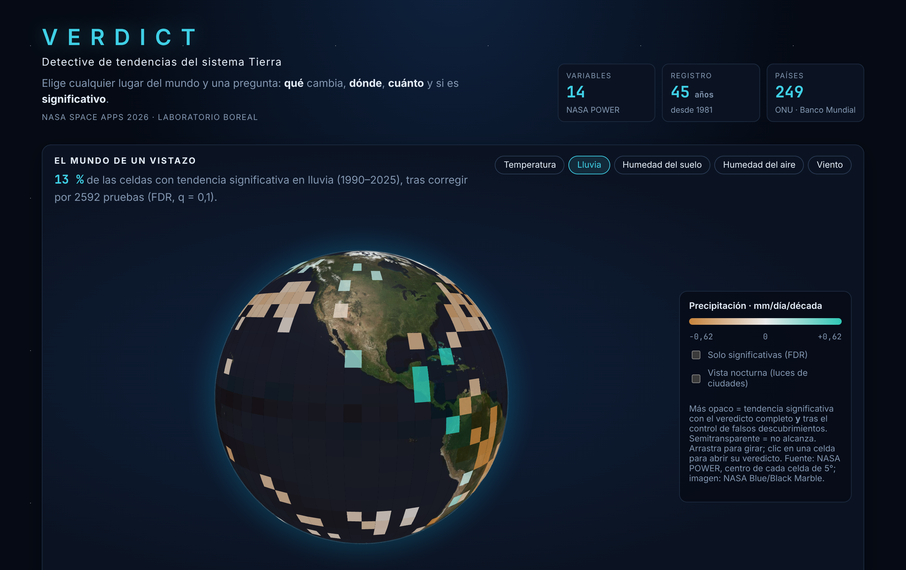

# Detective de tendencias del sistema Tierra · NASA Space Apps 2026

**Equipo:** Laboratorio Boreal · **Reto:** *Be an Earth System Trend Detective*

Una herramienta para que estudiantes y público con algo de formación científica investiguen
si algo está cambiando en **cualquier lugar del mundo**. Responde **qué** cambia, **dónde**,
**cuánto** y si el cambio es **significativo** o podría ser casualidad. El recorrido es
**preguntar → ver → veredicto**, según el análisis del equipo
([PDF](docs/Earth_System_Trend_Detective_analisis_y_solucion.pdf)).



- **Globo 3D (portada):**
  - el mundo entero de un vistazo: 2.592 celdas de 5° coloreadas con su tendencia
    (temperatura, lluvia, humedad del suelo, humedad del aire, viento);
  - con el mismo veredicto y control de falsos descubrimientos (FDR) para miles de pruebas;
  - clic en una celda para abrir su veredicto.
- **Preguntar:**
  - pregunta libre, que la IA o unas reglas convierten en variables del catálogo;
  - búsqueda por nombre o clic en el mapa, con detección automática del país;
  - recomendador por reglas: hasta 3 variables con definición, fuente y nota de fiabilidad.
- **Veredicto:**
  - motor estadístico resistente a la autocorrelación (Mann-Kendall con preblanqueo y regresión
    con tamaño de muestra efectivo), validado por simulación;
  - cuatro niveles: significativa, todavía no (con los **años de datos que faltan**), sin
    tendencia clara y datos insuficientes;
  - avisos de sensibilidad al periodo y de saltos bruscos.
- **Escenario futuro:** qué valor tendría la variable si el ritmo continuara, con intervalo del
  95 %. Se presenta como escenario, no como predicción.
- **Comparar lugares:** la misma variable en dos puntos cualesquiera, lado a lado.
- **Satélite:** imágenes Landsat/Sentinel-2 del lugar año a año desde 1984 y cobertura del suelo
  anual (cuánto crece la zona construida).
- **Población:** datos de la ONU de cualquier país con la proyección oficial hasta 2100.
- **Clima y sociedad:** relación con indicadores del Banco Mundial, separando la correlación
  aparente de la de año a año.
- **Explicar:** la IA (Claude) explica cada resultado usando solo las cifras del motor. Sin clave
  de IA, explica una plantilla.

Datos: NASA POWER (MERRA-2/CERES), Microsoft Planetary Computer (Landsat, Sentinel-2, cobertura
del suelo), ONU vía Our World in Data y Banco Mundial. Todos sin clave.

- Método, validación y límites: [docs/RETO.md](docs/RETO.md)
- Guía de estudio: [docs/GUIA_ESTUDIO.md](docs/GUIA_ESTUDIO.md)
- Memoria del proyecto: [docs/MEMORIA_PROYECTO.md](docs/MEMORIA_PROYECTO.md)

## Arranque rápido

Requisitos: [uv](https://docs.astral.sh/uv/), Node 22 y `make`.

```bash
make setup
```

```bash
make backend
```

```bash
make frontend
```

- Web: http://localhost:5173
- API y documentación interactiva: http://localhost:8000/docs

Funciona sin claves. Para la explicación con IA, pon tu `ANTHROPIC_API_KEY` en `.env`. Si NASA POWER o el Banco Mundial no responden durante la demo, las
regiones de ejemplo y sus países usan muestras guardadas en `backend/app/data/samples/`
(se actualizan con `make samples`). La API del Banco Mundial a veces tarda mucho.

## Estructura

```
backend/
  app/catalog.py           Variables (con definiciones), temas, regiones y ejemplos
  app/services/power.py    Cliente de NASA POWER con caché y respaldo sin conexión
  app/services/trends.py   Estadística: estacionalidad, Theil–Sen, Mann-Kendall, OLS, saltos
  app/services/worldbank.py  Indicadores del Banco Mundial con caché y muestras sin conexión
  app/services/relate.py   Correlación aparente y año a año (sin tendencias)
  app/services/forecast.py   Escenario lineal con intervalo de predicción
  app/services/places.py   Búsqueda de lugares y país de una coordenada
  app/services/demography.py  ONU (Our World in Data) para cualquier país
  app/services/satellite.py  Landsat/Sentinel-2 y cobertura del suelo (Planetary Computer)
  app/services/ai.py       IA con Claude, con reglas y plantillas de respaldo
  app/main.py              API: /api/catalog, /api/trend, /api/scan, /api/compare
  app/data/samples/        Datos guardados de las regiones de ejemplo
frontend/                  React + Vite + TypeScript + Recharts
notebooks/                 Exploración con el mismo código de la API
docs/                      Método, ofertas globales y lista de entrega
```

## API

| Endpoint | Qué devuelve |
|---|---|
| `GET /api/catalog` | Temas, variables, preocupaciones, tipos de lugar, países, demografía, ejemplos |
| `GET /api/places/search?q=Estelí` | Lugares del mundo por nombre |
| `GET /api/places/locate?lat=&lon=` | País y lugar más cercano a una coordenada |
| `GET /api/recommend?concern=drought&place_type=farmland` | Hasta 3 variables recomendadas |
| `POST /api/ask` `{question}` | Pregunta libre → preocupación, tipo de lugar, variables y lugares |
| `GET /api/trend?variable=&lat=&lon=&start=` | Serie y veredicto de una variable en un punto |
| `GET /api/forecast?variable=&lat=&lon=&to_year=` | Escenario si el ritmo continúa |
| `GET /api/scan?lat=&lon=` | Todas las variables ordenadas por evidencia |
| `GET /api/compare?variable=` | Una variable en las regiones de ejemplo |
| `GET /api/demography?country=NIC&indicator=population&to_year=2050` | Demografía, tendencia, escenario y proyección de la ONU |
| `GET /api/satellite/timeline?lat=&lon=` | Imágenes de satélite año a año |
| `GET /api/satellite/landcover?lat=&lon=` | Cobertura del suelo anual y escenario de zona construida |
| `GET /api/relate?variable=&indicator=&country=&lat=&lon=` | Relación con un indicador del Banco Mundial |
| `POST /api/explain` `{kind, ...}` | Explicación en lenguaje llano (IA o plantilla) |
| `GET /api/globe` | Malla global precalculada para el globo 3D |

## Comandos

| Comando | Qué hace |
|---|---|
| `make test` | Pruebas del backend (estadística con datos sintéticos y API sin red) |
| `make lint` | Revisa estilo en backend y frontend |
| `make notebook` | Abre JupyterLab |
| `make build` | Compila la web para desplegar |
| `make samples` | Vuelve a descargar las muestras sin conexión |
| `make globe` | Recalcula la malla del globo 3D |

Extras opcionales para otras fuentes (MODIS, GPM, AIRS, Planetary Computer) y la nube:
`make setup-all`. Ver [docs/OFERTAS.md](docs/OFERTAS.md).

## Entrega

Ver [docs/ENTREGA.md](docs/ENTREGA.md).

## Licencia

MIT
