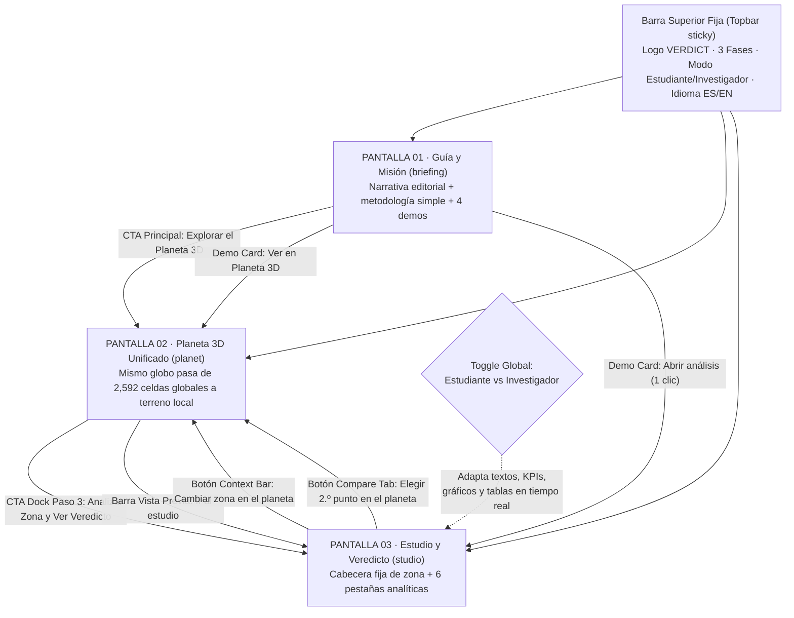
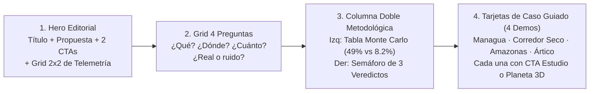
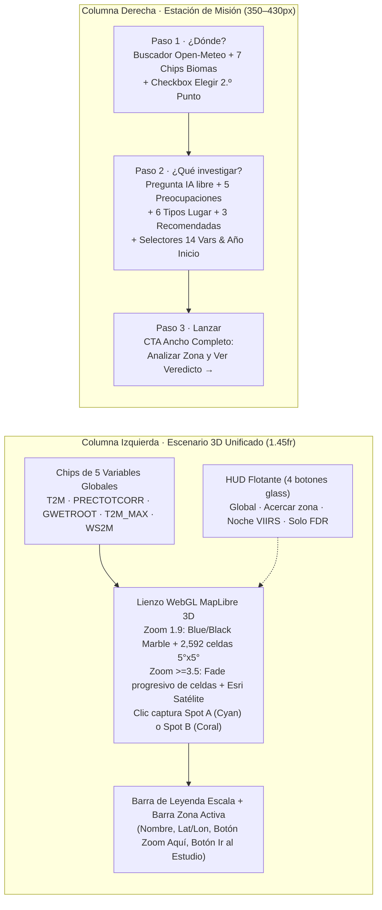
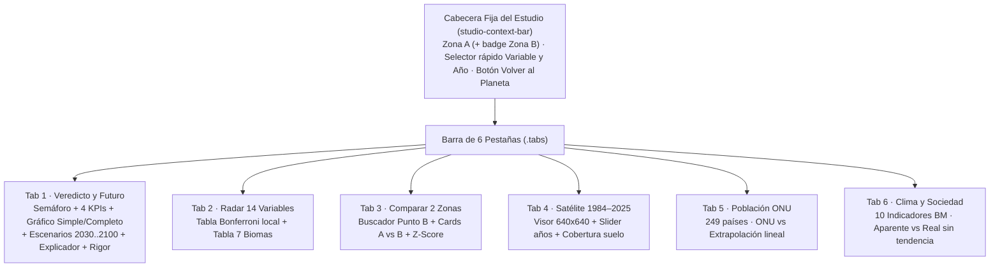

# VERDICT · Diagrama de Flujo y Especificación de Pantallas para Diseño UI/UX

> **Propósito:** Documento de referencia para el equipo de diseño (Figma / UI). Detalla la arquitectura de navegación en 3 fases, los flujos interactivos, la dualidad `Estudiante` vs. `Investigador` y el inventario exacto de componentes, estados y tokens visuales de cada pantalla de la aplicación web.  
> **Documento complementario:** [DESIGN.md](DESIGN.md)

---

## 1. Sistema Visual Base ("Orbital Observatory")

| Token | Valor | Uso principal |
|---|---|---|
| `--bg` | `#040812` | Lienzo espacial oscuro con gradiente orbital radial (`#0f2546` en borde superior) |
| `--panel` | `rgba(11, 19, 34, 0.88)` | Paneles principales con `backdrop-filter: blur(14px)` y borde `1px solid #1b2a42` |
| `--panel-2` | `#0f1a2d` | Tarjetas secundarias internas y celdas interactivas |
| `--ink` / `--muted` | `#e7eef8` / `#8ea2be` | Texto principal de alto contraste / etiquetas y subtítulos |
| `--accent` / `--emerald` | `#3fd0e6` / `#34d399` | Acción primaria, Punto A en el globo, tendencia **confirmada**, barra de certeza alta |
| `--amber` | `#f2b84b` | Estado **En observación / Todavía no**, alertas de calidad / reanálisis |
| `--no` | `#9aabc4` | Estado **Estable / Sin tendencia clara** |
| `--purple` | `#a78bfa` | Escenarios futuros proyectados, extrapolación lineal y módulo explicador IA |
| Punto B comparación | `#f59e42` | Marcador y borde lateral del segundo punto de comparación geográfica |
| Tipografía UI | `'Inter', system-ui, sans-serif` | Títulos editoriales, controles y explicaciones narrativas |
| Tipografía Numérica | `'JetBrains Mono', ui-monospace` | Coordenadas, tasas, porcentajes, años y tablas (`tabular-nums`) |
| Radios y Breakpoints | `18px / 14px / 999px` · `1024px` y `680px` | Hero (`18px`), paneles (`14–16px`), pills (`999px`); tablet `<=1024px`, móvil `<=680px` |

---

## 2. Flujo Maestro de Navegación (Vista Completa)

La web NO concatena controles y tablas en una sola página larga: divide la experiencia en **3 pantallas secuenciales** dentro de una carcasa fija (`AppShell`).

---

## 3. Barra Superior Fija (`Topbar` — Persistente en todas las pantallas)

Ancho máximo centrado de contenido: `1360px` (`sticky`, `top: 0`, `z-index: 40`, fondo translúcido con blur).

| Zona | Elemento | Comportamiento y estados |
|---|---|---|
| **Izquierda** | Botón de marca (`brand-btn`) | Logotipo `VERDICT` (cyan con glow) + subtítulo `Earth System Trend Detective`. Clic vuelve a **Pantalla 01**. |
| **Centro** | Selector de Fases (`.phase-nav` pill) | 3 botones pill: `01 · Guía y Misión`, `02 · Planeta 3D` (muestra punto verde `.phase-dot` si ya hay zona elegida), `03 · Paneles y Veredicto` (añade etiqueta corta con el nombre de la zona activa). En móvil (`<=680px`) ocupa el 100% del ancho debajo del logo. |
| **Derecha** | Controles Globales (`.topbar-controls`) | **1)** Segmented control `Estudiante` / `Investigador` (cambia el lenguaje estadístico, gráfico por defecto y acordeón de rigor). **2)** Segmented control `ES` / `EN` (bilingüe instantáneo). |

---

## 4. Pantalla 01 · Guía y Misión (`briefing`)

**Objetivo de diseño:** Poner en contexto al usuario en menos de 45 segundos antes de enfrentarlo a controles o tablas.

### Checklist de componentes de Pantalla 01

1. **Hero Editorial (`.briefing-hero` — 2 columnas `1.35fr / 0.85fr`, apila en `<=1024px`)**
   - Pill superior (`.kicker-pill`): `NASA SPACE APPS 2026 · EARTH TREND DETECTIVE`
   - Título H1 (`.hero-title`) + Párrafo de misión (`.hero-sub`): explica en lenguaje llano por qué las líneas de tendencia normales mienten en clima.
   - Botonera CTA (`.hero-ctas`): Botón primario `Explorar el Planeta 3D →` + Botón secundario `Ver investigaciones guiadas` (scroll suave a `#briefing-demos`).
   - Grid de telemetría (`.hero-telemetry`, 4 `.telemetry-tile`): `14` variables NASA POWER · `45 años` (1981–2025) · `2,592` celdas (`5°×5°`) · `249` países ONU.
2. **Las 4 Preguntas del Detective (`.question-grid`, 4 `.q-card`)**
   - Tarjeta 1: *¿Qué cambia?* · Tarjeta 2: *¿Dónde?* · Tarjeta 3: *¿Cuánto y desde cuándo?* · Tarjeta 4: *¿Realidad o azar?*
3. **Bloque Comparativo Metodológico (`.briefing-two-col`, 2 columnas `1.15fr / 0.85fr`)**
   - **Izquierda · Por qué mienten los gráficos normales:** Tabla Monte Carlo (`.bench-table`) contrastando porcentaje de falsas alarmas de Regresión Estándar (`19.3% – 49.0%` en `--red`) frente a VERDICT (`3.6% – 8.2%` en `--emerald`) según nivel de autocorrelación `AR(1)`.
   - **Derecha · Semáforo del Veredicto (`.semaforo-list`):** 3 tarjetas con barra lateral izquierda de color: Confirmado (`--accent`), En observación / Todavía no (`--amber` — explica estimación de años faltantes) y Estable / Sin tendencia clara (`--no`).
4. **Investigaciones Guiadas en 1 Clic (`#briefing-demos`, `.demo-grid`, 4 `.demo-card`)**
   - Cada tarjeta incluye: Tag de variable (`.demo-var-tag`), título del caso, breve resumen, botón primario (`Abrir análisis →` → **Pantalla 03**) y botón secundario (`Ver en Planeta 3D` → **Pantalla 02** enfocada en esa coordenada).

---

## 5. Pantalla 02 · Planeta 3D Unificado + Estación de Control (`planet`)

**Objetivo de diseño:** Reemplazar los dos mapas separados del prototipo original por **un único globo terráqueo interactivo** que transicióna de escala planetaria a escala de barrio sin cambiar de componente.

### Checklist de componentes de Pantalla 02

1. **Columna Izquierda · Escenario del Globo (`.globe-stage`)**
   - **Cabecera (`.globe-head`):** Título del visor + 5 chips rápidos para cambiar la capa planetaria al instante (`Temperatura`, `Lluvia`, `Humedad del suelo`, `Calor máximo`, `Viento`).
   - **Banda de Telemetría (`.globe-telemetry-strip`):** Rango temporal analizado, conteo de celdas con significancia tras filtro FDR (`q = 0.10`) y badge dinámico del nivel de zoom actual (`Escala Global` vs `Regional` vs `Local`).
   - **Viewport WebGL 3D (`.globe-viewport-box` / `Globe3D`):**
     - Altura fluida: `clamp(390px, 56vh, 580px)`.
     - HUD superior derecho (`.globe-hud`): 4 botones translúcidos con blur (`Vista global z=1.9`, `Acercar a la zona z=6.8`, `Modo noche Black Marble`, `Solo celdas significativas FDR`).
     - Regla visual de transición macro → micro: entre `zoom 3.5` y `zoom 5.8`, la ortofoto de alta resolución **Esri World Imagery** aparece progresivamente y las celdas `5°×5°` reducen su `fill-opacity` (`1.0 → 0.08`) dejando solo el contorno fino para no tapar calles, cultivos ni cuencas.
     - Regla de clic: si `zoom < 3.6`, el clic se ajusta al centro de la celda de `5°×5°`; si `zoom >= 3.6`, captura la coordenada exacta (`4 decimales`) bajo el puntero.
     - Marcadores: Punto A (`#3fd0e6`) y, si está activo `pickSecond`, Punto B (`#f59e42`). Tooltip `.globe-tip` al hover.
   - **Barra de Leyenda (`.globe-footer-bar`):** Barra graduada azul-cyan ↔ rojo-ámbar con etiquetas mín/máx + texto guía de interacción según el nivel de zoom.
   - **Barra de Vista Previa de Zona Activa (`.zone-preview-bar`):** Nombre geolocalizado, país, coordenadas en fuente mono, pill opcional del Punto B (`.second-pill`), botón `Hacer zoom aquí` y botón `Ir al estudio →`.
2. **Columna Derecha · Estación de Control en 3 Pasos (`.control-dock`)**
   - **Tarjeta Paso 1 · Ubicación:** Input + botón buscar (Open-Meteo geocoding con dropdown `.results`), 7 chips rápidos (`Managua`, `Corredor Seco`, `Bluefields`, `Amazonas`, `Sáhara`, `Ártico`, `CDMX`) y checkbox `Elegir 2.º punto en el planeta para comparar`.
   - **Tarjeta Paso 2 · Variable y Pregunta:** Campo de texto libre (`/api/ask` — interpreta pregunta en español/inglés), fila de 5 chips de preocupación (`Calor`, `Agua/lluvia`, `Sequía`, `Sol`, `Viento`), fila de 6 chips de tipo de lugar (`Ciudad`, `Cultivos`, `Bosque`, `Costa`, `Seco`, `Frío`), lista de 3 tarjetas recomendadas (`.recs-list`), par de selects (`Variable completa [14]` y `Año inicio [1981–2005]`), más caja informativa `.definition` sobre resolución y limitaciones de reanálisis.
   - **Tarjeta Paso 3 · Lanzamiento (`.launch-card`):** CTA gigante `Analizar Zona y Ver Veredicto →` con subtítulo resumen de zona + variable seleccionadas.

---

## 6. Pantalla 03 · Estudio Analítico y Veredicto (`studio`)

**Objetivo de diseño:** Mostrar el veredicto de inmediato en lenguaje claro y adaptarlo dinámicamente entre `Estudiante` (lenguaje visual, medidores en %, gráfico limpio) e `Investigador` (p-values exactos, `τ`, `n_eff`, anomalías mensuales, tabla metodológica expandida).

### 6.1 Cabecera y Barra de Pestañas (Persistentes dentro de Pantalla 03)
- **`.studio-context-bar`:** Muestra tag de zona activa, nombre del lugar y país, coordenadas `.num`, chip naranja si existe Punto B, selectores rápidos (`Variable`, `Desde año`) sin regresar al globo, y botón secundario `🌍 Cambiar zona en el planeta`.
- **`.tabs`:** 6 botones horizontales flexibles con estado activo `aria-selected="true"`.

### 6.2 Detalle por Sub-pantalla (Tabs 1 a 6)

| Tab | Bloques que debe diseñar | Diferencia clave `Estudiante` vs. `Investigador` |
|---|---|---|
| **1. `trend` · Veredicto y Futuro** | **1)** Banner Semáforo (`.verdict` + `.badge.lg`). **2)** Grid de 4 KPIs (`.kpi-grid`): Dirección (`↑/↓/→`), Ritmo/década + cambio total + rango 95%, Barra de **Certeza Estadística** (`.meter-track`), Barra de **Suficiencia de Datos** (`años obs / años necesarios`). **3)** Alertas de calidad (`.warnings`). **4)** Tarjeta Gráfico (`TrendChart`) con toggle **Simple** / **Completo**. **5)** Tarjeta Escenario Futuro (`.scenario-card`, borde violeta): 5 pills `2030, 2040, 2050, 2075, 2100` con advertencia visible *"Escenario si continúa el ritmo actual"* . **6)** Botón/Caja **Explicador** (`.explain-btn` / `.explain-box`). **7)** Tarjeta **Rigor Científico** (`.rigor-card` colapsable): tabla comparativa Mann-Kendall Preblanqueado vs OLS `n_eff`. | En **Estudiante**: KPI muestra `% de certeza` y años faltantes; gráfico abre en **Vista Simple** (sin ruido mensual); alertas van en lenguaje llano; card Rigor inicia **colapsada**. En **Investigador**: KPI muestra `MK p`, `OLS p_eff`, `τ`, `n_eff`, lag-1 `r`; gráfico abre en **Vista Completa** (con puntos de anomalías mensuales); alertas muestran prueba de Pettitt; card Rigor inicia **abierta**. |
| **2. `scan` · Radar 14 Variables** | **1)** Tabla local escaneando las **14 variables** en el punto activo (ritmo, dirección, veredicto ajustado con corrección **Bonferroni**). Clic en fila carga esa variable en Tab 1. **2)** Tabla comparativa entre los **7 biomas de referencia** para la variable activa. | En **Estudiante**: prioriza columna de badge/veredicto visual. En **Investigador**: expone `p` ajustado y tamaño efectivo. |
| **3. `compare` · Comparar 2 Zonas** | **1)** Barra superior con estado del Punto A + botón `Elegir en Planeta 3D` + buscador Open-Meteo para Punto B + 7 chips de biomas rápidos. **2)** Dos tarjetas espejo lado a lado: `.side-a` (borde superior cyan) vs `.side-b` (borde superior coral `#f59e42`) con tasa, certeza y años necesarios. **3)** Gráfico único comparativo en **puntajes z estandarizados** para comparar variables/regiones distintas sin distorsión de escala. | Reutiliza si el usuario ya marcó el Punto B desde la Pantalla 02 (`pickSecond`). |
| **4. `satellite` · Satélite 1984–2025** | **1)** Grid 2 columnas (`.sat`): Visor cuadrado **640×640 px** (`16×16 km`, aspect-ratio `1:1`) a la izquierda; slider temporal + chips de años + badge con sensor (`Landsat 5/7/8/9` o `Sentinel-2`), fecha exacta y `% de nubes` a la derecha. **2)** Barras horizontales de cobertura de suelo (**Top 5 clases** ESA / Impact Observatory). **3)** Gráfico multiclase `2017–2023`. **4)** Escenario de expansión urbana con pills `2030, 2035, 2040, 2050` + `SeriesChart` + módulo `Explain`. | Manejo explícito de estado vacío/error si la nubosidad supera el umbral en alguna fecha o si se navega sin proxy raster directo. |
| **5. `population` · Población ONU** | **1)** Barra de controles: selector `249 países`, `7 indicadores demográficos ONU`, horizonte `2030–2100`. **2)** 4 tarjetas KPI: último valor observado, ritmo reciente, proyección oficial **ONU WPP** (`#34d399` esmeralda) y extrapolación lineal ingenua (`--purple` violeta) evidenciando dónde divergen. **3)** Gráfico `SeriesChart` combinado + módulo `Explain`. | Enfocado en mostrar visualmente la diferencia entre extrapolación lineal ciega y proyección demográfica oficial. |
| **6. `relate` · Clima y Sociedad** | **1)** Barra `.relate-controls`: selector de 10 indicadores del Banco Mundial (desnutrición, mortalidad calor, rendimiento agrícola, electricidad renovable, estrés hídrico, etc.), selector país y botón `Comparar`. **2)** Banner veredicto narrativo. **3)** 4 tarjetas KPI: Correlación real año a año (`detrended r` con barra medidora), Correlación aparente (`raw r` con aviso de **trampa de tendencia compartida**), años traslapados, tendencia del indicador. **4)** Alertas + 2 gráficos en paralelo (`.charts`): serie doble normalizada `z-score` + diagrama de dispersión `ScatterChart` sin tendencia. **5)** Módulo `Explain`. | Resalta en ámbar si `raw r` es alto pero `detrended r` cae cerca de `0` (correlación espuria). |

---

## 7. Estados Transversales que el Diseñador Debe Cubrir

| Estado | Pantalla(s) | Comportamiento visual especificado |
|---|---|---|
| **Carga / Fetching** | Pantallas 02 y 03 | Mensaje discreto en línea / deshabilitado de botones primarios sin bloquear el cambio de pestaña ni el globo existente. |
| **Error de fuente externa** | Todas | Caja `.error` (`--red-bg` con borde `rgba(255,122,122,0.35)` y texto `--red`), manteniendo visible la cabecera para cambiar zona o país. |
| **Sin tendencia / Serie corta** | Pantalla 03 (`trend`) | Badge gris `--no`, barra de suficiencia parcial en `--amber` indicando años faltantes (fórmula de Weatherhead). |
| **Responsive Tablet (`<=1024px`)** | Pantallas 01 y 02 | Hero, bloque Monte Carlo/Semáforo y Planeta+Dock apilan a `1 columna`. |
| **Responsive Móvil (`<=680px`)** | Todas | Stepper de fases ocupa todo el ancho, visor satélite apila controles debajo de la imagen y `.relate-controls` apila verticalmente. |
